# Net2RF LED

**Show network to 433 MHz RF.** Pixel or DMX data in over DDP or E1.31, radio out. Drives 433 MHz wireless
LED show products (the bracelets, light sticks, pucks and wands handed out at concerts and stadiums) from
**xLights, Falcon Player or any DDP / E1.31 source**.

```
xLights / FPP ──DDP / E1.31──▶ WT32-ETH01 (ESP32 + Ethernet) ──▶ CC1101 or Ra-02 ──433 MHz──▶ bracelets, sticks, pucks
```

In xLights, a group of bracelets is just a **single pixel**. Import the ready-made model
([`tools/xlights`](tools/xlights/)), put it on the controller, and sequence *All Zones* or each zone by name;
add it to an existing model group (your floods, say) and the crowd's bracelets follow along. No DMX fixtures
to set up. Already have the bracelets set up as DMX (for example for the vendor's DMX transmitter)? That
configuration should keep working, using the DMX input mode (colours tested) or the vendor mode (not yet
tested on hardware).

**▶ See it working:** [prototype demo on YouTube](https://youtube.com/shorts/mfn99Rj19TI): breadboard build,
a bracelet following an xLights sequence, and the web UI.

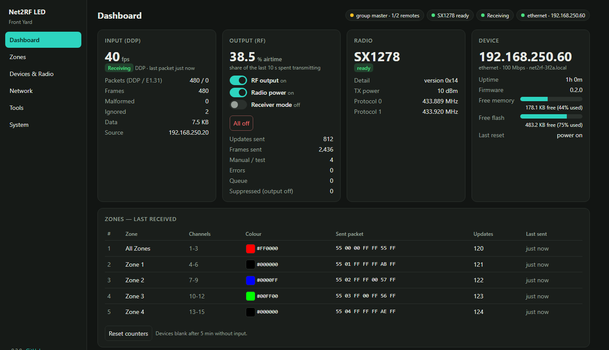

**The carrier board, in its printed case:** WT32-ETH01, Ra-02 radio, OLED and buttons on one board
([photos](#carrier-board-photos)).

<p>
<a href="docs/images/carrier/board-assembled.jpg">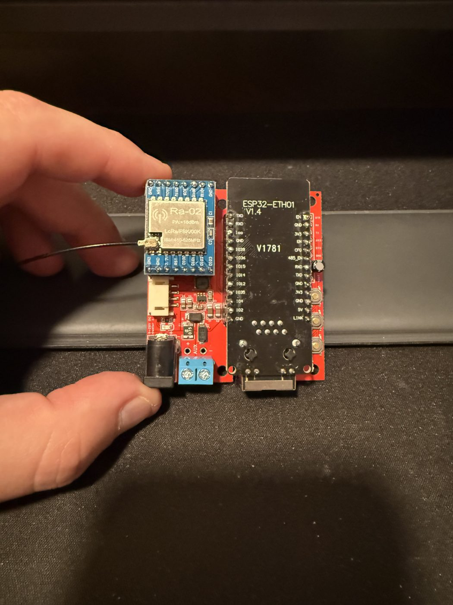</a>
<a href="docs/images/carrier/amp-closed.jpg">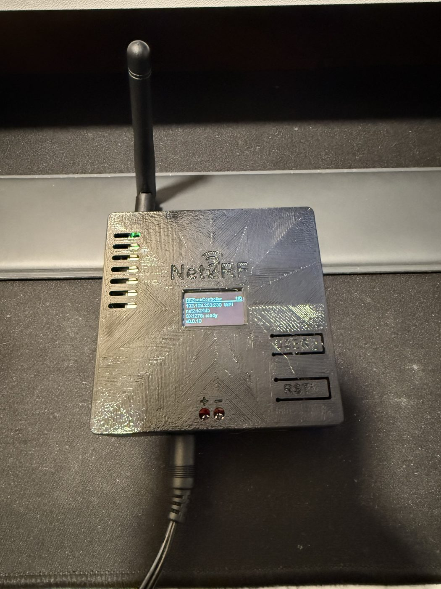</a>
<a href="docs/images/carrier/slim-ext-closed.jpg">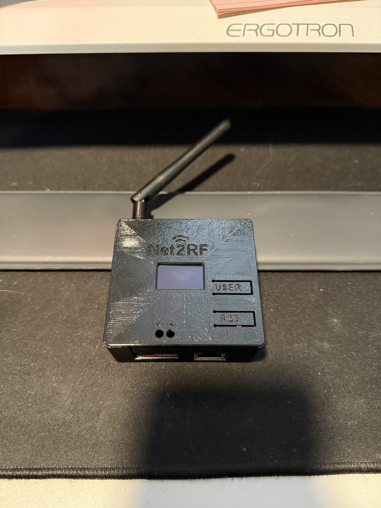</a>
</p>

## Project status

> **Early prototype: DIY build or the R2.0 carrier board.** It works end to end: an xLights sequence drives
> bracelets over DDP, in zones, and devices on both RF protocols have been driven. Expect rough edges, and
> please report what you find.

| | |
|---|---|
| ✅ **Tested** | WT32-ETH01 + CC1101 (433 MHz) DIY build · **Carrier board R2.0** with the **Ra-02 / SX1278** radio, in both printed cases ([photos](#carrier-board-photos)) · **Wally's Lights** wristbands, pucks, wand and Santa hat (protocol 1) · **Shenzen New Dody** bracelets (protocol 0), two bracelets · xLights over **DDP, pixel mode** · **DMX** input mode (colours) · **E1.31** unicast · web UI, Wi-Fi setup through the setup hotspot, firmware updates over the network · SSD1306 and SSD1315 OLEDs, OLED wake · USER button, network and factory resets · group tester and range walk · **range across a yard**, with and without the external amplifier · **FPP** as the show player, and its MultiSync page · zone walk and address probe · group-mask addressing, the All Zones base layer and one packet per colour · bracelet fade in / fade out · xLights custom model, *Upload Output* and *Discover* · update check and install from GitHub releases · controller list and `net2rf.local` election (against simulated controllers) |
| 🧪 **Built, not yet tested on hardware** | **XIAO ESP32-S3** build (Wi-Fi only) · **Receiver mode** (decoder tested against the encoder with timing errors and noise) · **LedGiftSupplier**-branded bracelets (protocol 1, full 8-bit RGB + group codes, matched to off-air captures of the vendor's transmitter) · **vendor DMX** input mode · E1.31 multicast · two real controllers side by side, listen before transmit backing off · Home Assistant examples |
| 🛠 **Coming soon** | **FPP plugin:** each zone follows FPP models (your floods, say) live, one colour per zone, kept within the radio's budget · **AI sequencing assistant:** adds the devices to your existing xLights sequences |

Full list of what's been tried: [docs/DEVICES.md](docs/DEVICES.md). What we know about the bracelets
themselves (the protocol 0 giveaway bracelets from a Banana Ball game):
- **Waking up:** they need a press of their button before they listen to the radio.
- **Idle behaviour:** they turn red by themselves after ~20 minutes without a command, but keep listening.
- **Effects:** besides colours and off, they have a built-in fade out to black and fade in to the last colour.
- **Zones:** protocol 0 uses a 16-bit group mask. The tested bracelets are on groups 2 and 3; others may differ. See
  [PROTOCOL.md](docs/PROTOCOL.md).

## Features

- **Two bracelet families:** Shenzen New Dody (10-colour palette) and LedGiftSupplier.com (RGB, group codes), on
  one controller: each zone drives protocol 0, protocol 1 or both, and only the protocols in use go on air.
  Wally's Lights' RF products use the LedGiftSupplier protocol too: their wristbands, pucks, wand and Santa hat
  all follow the controller.
  Bracelets and light sticks both work the same way.
- **Layered zones:** an All Zones layer under per-group zones, so a group keeps its own colour while everyone
  else follows the crowd-wide effect (protocol 0).
- **Zones:** up to 16 groups per controller, each one RGB pixel in xLights (pixel mode), a DMX fixture with an
  effect channel (DMX mode), or the vendor transmitter's 5-channel layout (vendor mode).
- **DDP and E1.31 input**, unicast or multicast; Ethernet or Wi-Fi, with a setup hotspot for first-time config.
- **Built-in tools:** group tester, range walk, live input monitor, transmit log, 433 MHz channel meter
  and identify, next to the protocol test and address probe.
- **Web UI for everything:** live input rate and counters, last colour per zone, test mode, zone walk, address
  probe ("which group is this bracelet in?"), xLights setup helper, network settings, firmware update (fetched by your browser from GitHub releases, or a file) with
  automatic rollback, settings export/import, optional admin password.
- **Stand-alone light modes:** fade through a colour palette (Halloween, Christmas and red, white & blue presets)
  or a candle flicker, optionally started at every power-up, with no show running.
- **Show-safe:** an RF output switch and an *All off* button; bracelets blank themselves when the show stops
  sending (5 minutes by default).
- **Discoverable:** answers Falcon Player's discovery ping, so FPP and xLights can find it on the network.
- **Several controllers:** each one lists the others with their live state, and one always answers at
  `net2rf.local`. Optional listen-before-transmit keeps neighbouring controllers from talking over each other.
- **Optional OLED and USER button:** IP and status at a glance; holding the button resets the network settings or
  the whole controller.
- **Receiver mode:** one switch turns the controller into a listener that decodes both bracelet protocols from
any transmitter in range and shows what every group was told, with signal strength, on the web UI and the OLED.
Raw captures of anything it can't decode, with a waveform view, bit guess and rtl_433 export.
- **Amplifier power switch:** an optional output that powers an external RF amplifier up and down.
- **JSON API:** for Home Assistant, Grafana or scripts.

## Hardware

| | Status | Guide |
|---|---|---|
| **DIY build:** WT32-ETH01 + CC1101 or Ra-02, wired by hand | Works today | [Assembly guide, part A](docs/ASSEMBLY.md#a-diy-build) |
| **XIAO ESP32-S3** + CC1101, Wi-Fi only (CrispyPyro's receiver wiring) | 🧪 Builds, untested | [Assembly guide, part C](docs/ASSEMBLY.md#c-xiao-esp32-s3) |
| **Carrier board R2.0:** WT32-ETH01 + Ra-02 plug in, OLED and buttons on board, [printed case](hardware/case/README.md) | Works today | [Assembly guide, part B](docs/ASSEMBLY.md#b-carrier-board) |

The DIY build needs:
- a WT32-ETH01;
- a 433 MHz CC1101 module with antenna;
- a 5 V supply;
- a 3.3 V USB-serial adapter for the first flash;
- optionally an OLED and three buttons.

Full parts list, with where to buy: [ASSEMBLY.md, Parts](docs/ASSEMBLY.md#parts).

### Carrier board photos

The first R2.0 carrier boards, built up and fitted in the [printed case](hardware/case/README.md). Click a
photo for the full size.

**The board:** bare, with the modules plugged in, and the back.

<p>
<a href="docs/images/carrier/board-parts.jpg">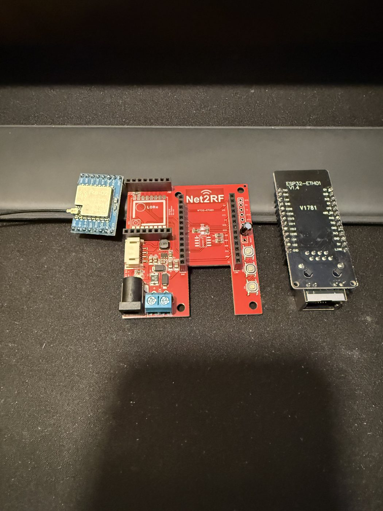</a>
<a href="docs/images/carrier/board-top.jpg">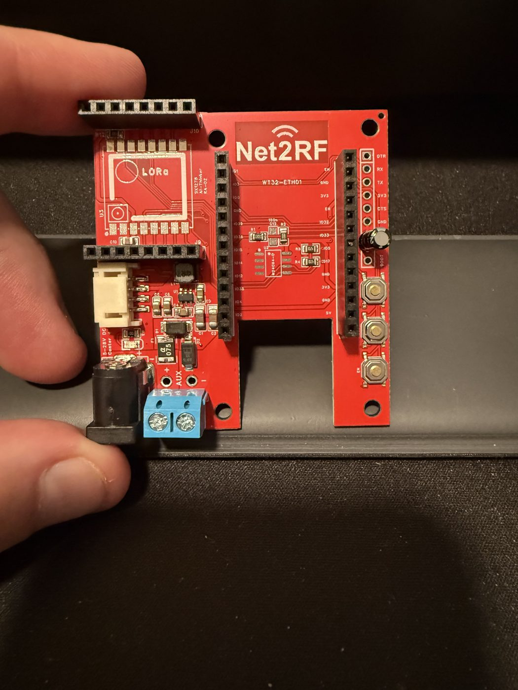</a>
<a href="docs/images/carrier/board-back.jpg">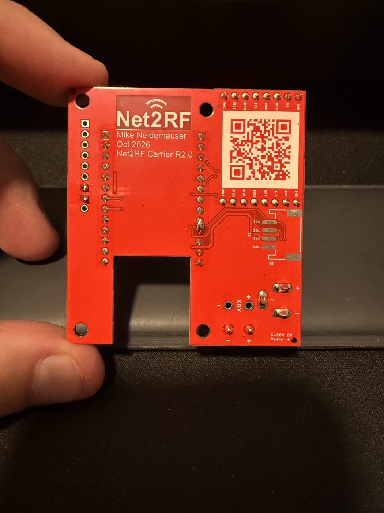</a>
<a href="docs/images/carrier/board-assembled.jpg"></a>
</p>

**Amp case:** the external 433 MHz amplifier stands along the left wall, with its 12 V to 5 V buck at the
far wall; the amp's SMA goes through the far wall.

<p>
<a href="docs/images/carrier/amp-inside.jpg">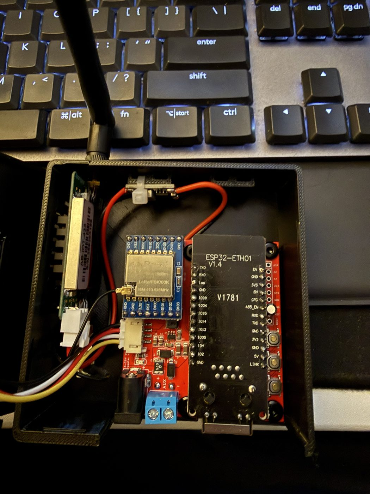</a>
<a href="docs/images/carrier/amp-open.jpg">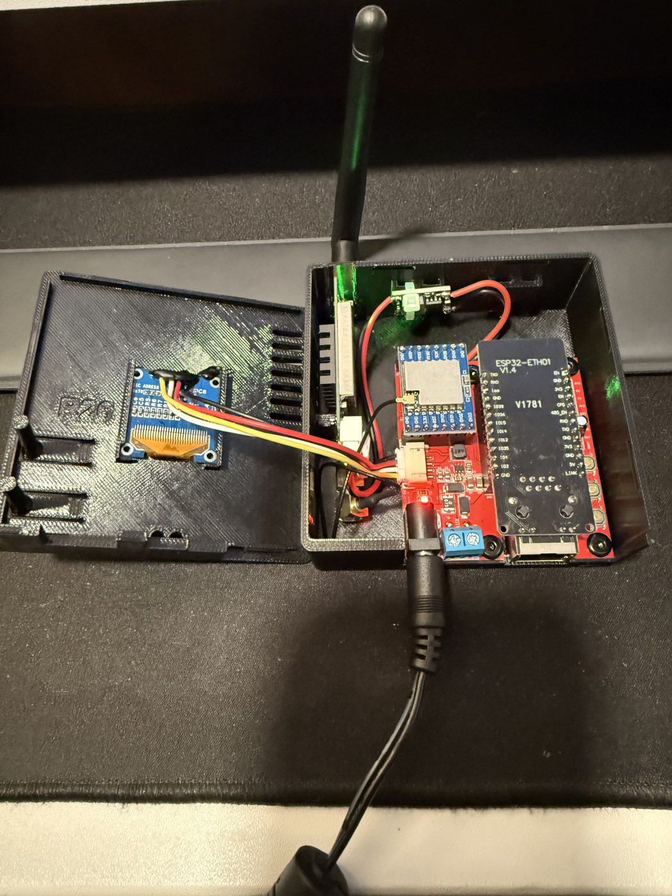</a>
<a href="docs/images/carrier/amp-closed.jpg"></a>
</p>

**Slim case, external antenna:** the Ra-02 pigtail's bulkhead SMA through the far wall.

<p>
<a href="docs/images/carrier/slim-ext-open.jpg">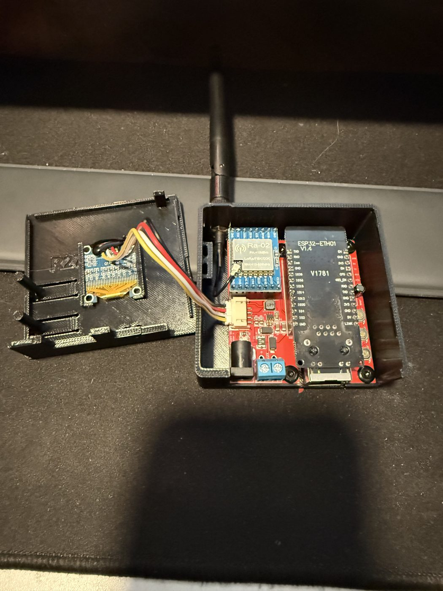</a>
<a href="docs/images/carrier/slim-ext-inside.jpg">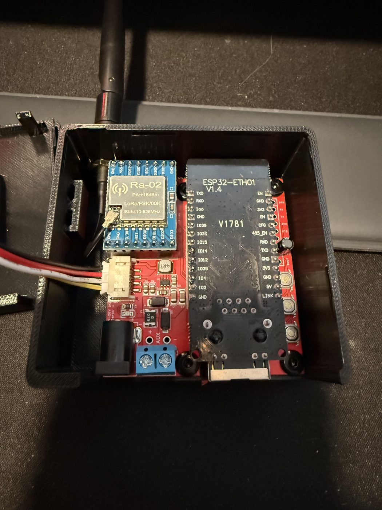</a>
<a href="docs/images/carrier/slim-ext-closed.jpg"></a>
</p>

**Slim case, internal antenna:** a spring antenna tied to the left wall, the antenna hole plugged.

<p>
<a href="docs/images/carrier/slim-int-closed.jpg">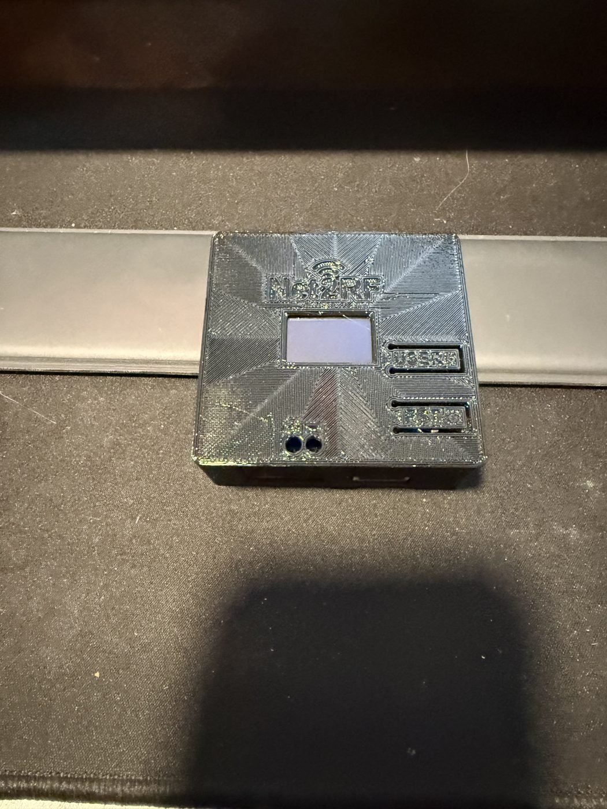</a>
<a href="docs/images/carrier/slim-int-open.jpg">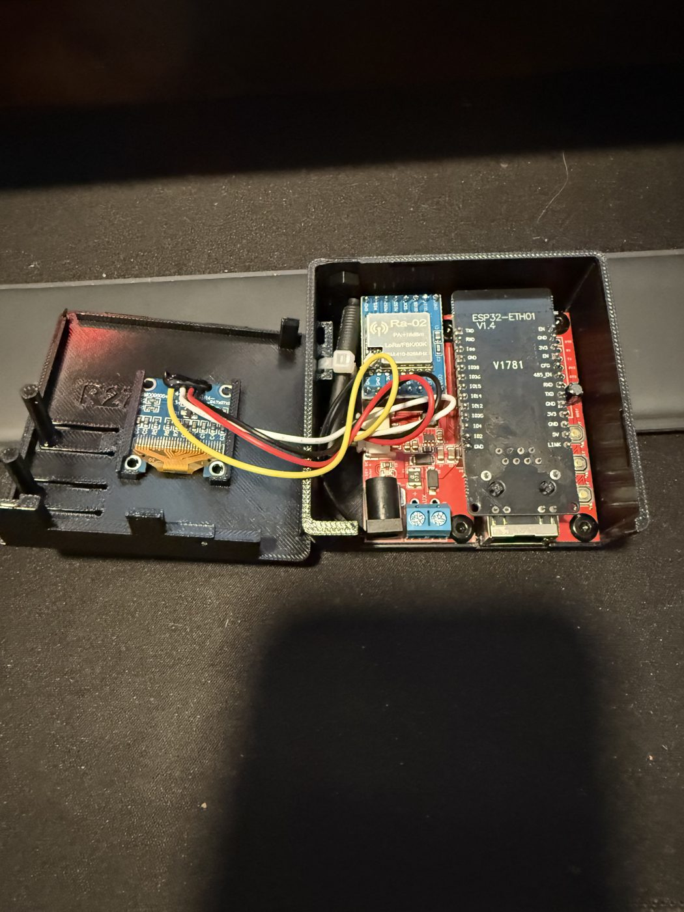</a>
<a href="docs/images/carrier/slim-int-inside.jpg">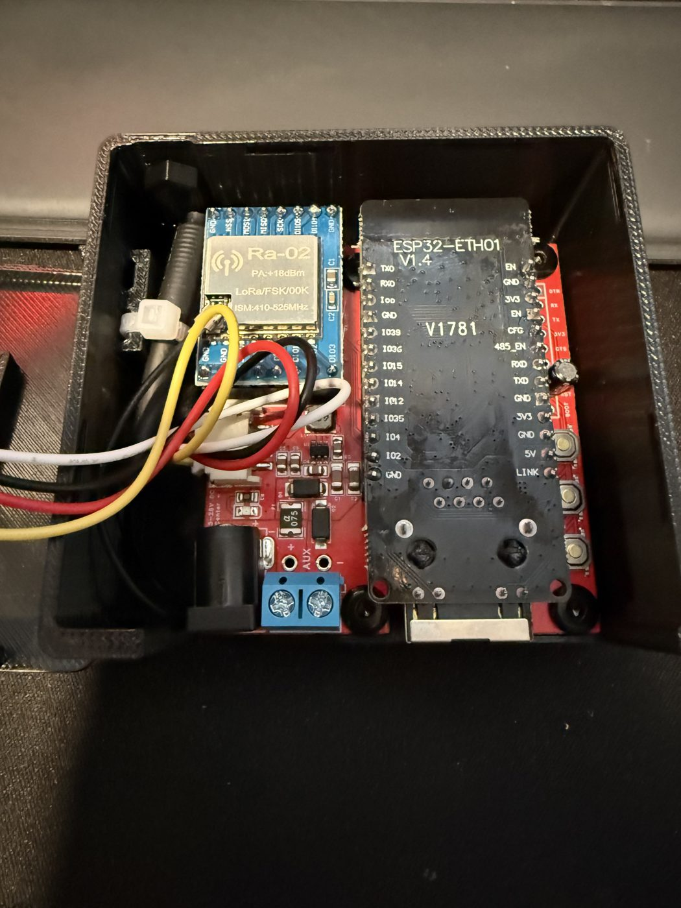</a>
</p>

## Getting started

1. **Build and flash:** [docs/ASSEMBLY.md](docs/ASSEMBLY.md) covers parts, pinout, wiring and flashing. The
   [browser flasher](https://mikeneiderhauser.github.io/net2rf-led/) (Chrome / Edge) installs the latest release over USB, no build tools needed.
2. **Get connected:** the [user guide](docs/USAGE.md) covers the network, the setup hotspot, the web UI and the
   buttons.
3. **Add the bracelets to your show:** [docs/SETUP.md](docs/SETUP.md) covers the show network, finding your
   bracelet type and groups, a range check, adding the controller to xLights / FPP, and sequencing tips.

## Documentation

| Doc | What's in it |
|---|---|
| [DEVICES.md](docs/DEVICES.md) | Tested bracelets and controller hardware, and how to report a new device |
| [ASSEMBLY.md](docs/ASSEMBLY.md) | Parts, pinout, wiring, first-time flashing |
| [USAGE.md](docs/USAGE.md) | User guide: connecting, setup hotspot, web UI, buttons/LED/OLED, updates, recovery |
| [SETUP.md](docs/SETUP.md) | Adding bracelets to an existing xLights / FPP show |
| [RF.md](docs/RF.md) | Range, multiple controllers, listen before transmit, key fobs, the rules |
| [PROTOCOL.md](docs/PROTOCOL.md) | The bracelets' 433 MHz protocols, and what's known about each |
| [API.md](docs/API.md) | HTTP API, settings, stats, controller discovery |
| [HOME_ASSISTANT.md](docs/HOME_ASSISTANT.md) | Sensors, switches and automations |
| [tools/xlights](tools/xlights/) | xLights custom models and controller definition |
| [hardware/case](hardware/case/README.md) | 3D-printed case for the carrier board: STLs and OpenSCAD source ([photos](#carrier-board-photos)) |
| [TODO.md](TODO.md) | Open items and things waiting for hardware tests |

## Roadmap

- **Carrier board:** the next revision fixes R2.0's MOSI routing (no J3 bridge) and its power-on start.
- **Broader testing:** LedGiftSupplier bracelets, vendor mode, two real
  controllers with listen before transmit.
- **Bracelet behaviour:** more bracelets and batches; idle and sleep (e.g. a keep-alive so bracelets don't
  drift to red between songs).
- **FPP plugin** (coming soon): zones follow models in FPP's running sequence, each reduced to one colour, with
  changes paced to what the radio can send, so existing shows drive the devices with no extra sequencing.
- **AI sequencing assistant** (coming soon): adds the Net2RF model to your existing xLights sequences, following
  what the rest of the show does, within the radio's budget.
- **xLights and FPP:** get the Net2RF controller definition into xLights, and a device type of its own in
  FPP's discovery, so a discovered controller is set up without manual steps.

Have bracelets from another vendor or batch, or ideas? Open an issue. Captures and test reports are especially
welcome; [DEVICES.md](docs/DEVICES.md#reporting-a-device) lists what helps.

## Development

```bash
pio run -e wt32-eth01                  # build firmware.bin and firmware.factory.bin
pio run -e xiao-esp32s3                # the same firmware for a Seeed XIAO ESP32-S3 (Wi-Fi only; docs/ASSEMBLY.md)
pio test -e native                     # unit tests: packets, scheduler, settings, receiver decoding, input parsers, radio maths, discovery
python3 tools/mock_server.py           # develop the web UI against a fake API at http://127.0.0.1:8765/
python3 tools/ddp_test.py <ip> cycle   # send DDP without xLights
python3 tools/peer_sim.py --to <ip>    # simulate other controllers on the network
```

| Path | What it is |
|---|---|
| `src/` | The firmware: engine (zones, scheduling, RF), network, web server, OLED/button, peers, updater |
| `web/index.html` | The web UI (gzipped into the firmware at build time) |
| `lib/net2rf_protocol` | Bracelet packet encoder and decoder, receiver zone tracking, DDP / E1.31 parsers (pure C++, unit tested) |
| `lib/cc1101_ook`, `lib/sx1278_ook` | Minimal radio drivers for OOK transmit and listen-before-talk |
| `lib/net2rf_heartbeat`, `lib/net2rf_fpp` | Controller heartbeat and FPP discovery ping formats (unit tested) |
| `lib/net2rf_wled` | The WLED config requests xLights' upload uses (unit tested) |
| `lib/net2rf_version` | Release version comparison for the update notice (unit tested) |
| `tools/xlights` | xLights models and controller definition, and the script that generates the models |

## License and legal

Copyright (C) 2026 Mike Neiderhauser and contributors.

Licensed under the **GNU General Public License v3.0 or later** ([LICENSE](LICENSE)). You may use, modify and
sell it, including in products. If you distribute it, modified or not (for example in a controller you sell),
you must make the corresponding source available under the same licence.

The bracelet protocols were worked out from the behaviour of a Flipper Zero app; no third-party code from it is
included. Libraries used at build time (ArduinoJson and the ThingPulse OLED driver, MIT; Arduino-ESP32 and
ESP-IDF) and the browser flasher (ESP Web Tools) carry their own licences.

433 MHz transmission is regulated. The controller transmits what it's sent, at the power you set; staying within
local rules is up to the operator. See [docs/RF.md](docs/RF.md#legal).
