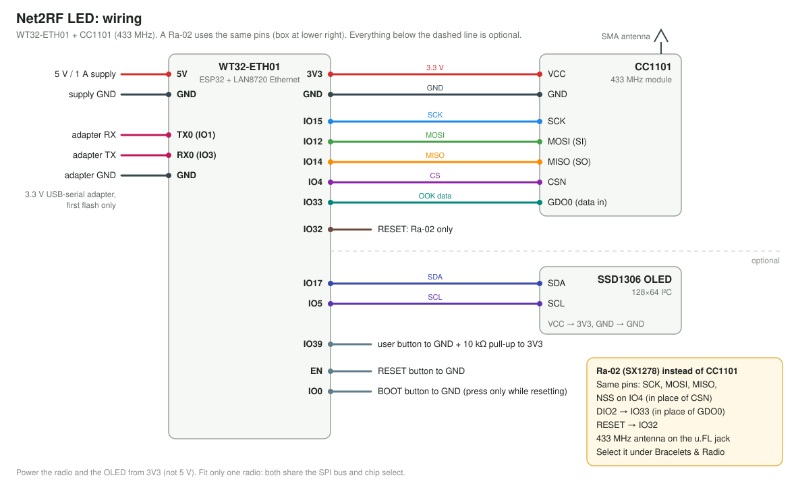

# Assembly and installation

Two ways to build a controller:

- **[A. DIY build](#a-diy-build)**: a WT32-ETH01 and a radio module wired together. Available now; this is
  what the firmware has been tested on.
- **[B. Carrier board](#b-carrier-board)**: the WT32-ETH01 and a Ra-02 plug into one board with the OLED and
  buttons, in a printed case. R2.0 is built and tested.
- **[C. XIAO ESP32-S3](#c-xiao-esp32-s3)**: a small Wi-Fi-only alternative, wired like
  [CrispyPyro/Wireless_DMX_Receiver](https://github.com/CrispyPyro/Wireless_DMX_Receiver). Builds; not yet tested
  on hardware.

A and B run the same firmware with the same pin assignment; C has its own build (`xiao-esp32s3`). Once flashed, the [user guide](USAGE.md) covers
connecting and everyday use, and [SETUP.md](SETUP.md) covers adding the bracelets to your show.

---

## A. DIY build

### Parts

| Part | Notes |
|---|---|
| **WT32-ETH01** ([Amazon](https://www.amazon.com/dp/B09Z298QJQ)) | ESP32 + LAN8720 Ethernet. Power it with 5 V; its own 3.3 V regulator also supplies the radio and OLED. (Not the "WT32-ETH01-EVO", which is a different chip and pinout.) |
| **Radio, one of:** | Chosen in the web UI (*Devices & Radio → Radio module*), no recompiling. Fit only one. |
| CC1101 module, **433 MHz** | The blue 2×4-header board with an SMA jack, e.g. [AOICRIE CC1101 + antenna](https://www.amazon.com/dp/B0D2TMTV5Z). −30 to +10 dBm. **Tested.** Multi-band listings ("315/433/868/915") are only tuned for one band: make sure yours is 433 MHz. |
| Ai-Thinker Ra-02 (SX1278, 433 MHz) | [Ra-02 module](https://www.amazon.com/SX1278-Ai-Thinker-Wireless-Spectrum-Transmission/dp/B0CP778J3T): +2 to +17 dBm, the long-range option, and the radio on the carrier board (tested). It has a u.FL antenna connector and 2 mm pads, so use a breakout: [ACROBOTIC Ra-02 breakout](https://www.amazon.com/ACROBOTIC-Breakout-Arduino-ESP8266-Raspberry/dp/B07MNH5W65), or [Adafruit RFM96W 433 MHz](https://www.adafruit.com/product/3073) (equivalent chip, 0.1" header). |
| 433 MHz antenna | Included with the linked CC1101. For the Ra-02: a u.FL→SMA pigtail + 433 MHz SMA whip. Mount it high. |
| 128×64 I²C OLED (optional) | SSD1306 (0.96", e.g. [this one](https://www.amazon.com/dp/B09T6SJBV5)) or SH1106 (1.3"), selectable under *System → Display*. Shows IP, radio status, input rate, zone colours. Everything works without it. |
| 3 × tactile buttons ([Amazon](https://www.amazon.com/dp/B01E38OS7K)) | EN (reset), BOOT (IO0), and an optional USER button on IO39. |
| 10 kΩ resistor ([Amazon](https://www.amazon.com/dp/B0BR68QQPF)) | Pull-up for the USER button (IO39 has no internal pull-up). |
| 330 Ω–1 kΩ resistor | In series with the radio data line (IO33). Cheap insurance against two outputs fighting. |
| 3.3 V USB-serial adapter | FT232 / CH340 / CP2102 "FTDI" board, e.g. [this FT232RL USB-C one](https://www.amazon.com/dp/B0DDGLRY1D), for the first flash only. Set it to **3.3 V**. |
| 5 V / 1 A supply | The controller draws ~400 mA worst case. |
| Breadboard ([Amazon](https://www.amazon.com/dp/B07LFD4LT6)) and Dupont jumper wires ([Amazon](https://www.amazon.com/dp/B01EV70C78)) | For a solderless build like the prototype. |

**Avoid** UART "LoRa" modules (EBYTE E32/E22, DL-LL02): they can't send raw OOK.

Links are examples of matching parts, not endorsements. Listings change, so check the band (433 MHz) before buying.

### Pinout



The WT32-ETH01 silkscreen labels some pins by their original serial-bridge function; both names are given below.

#### Radio (fit one; both use the same pins)

A new or reset WT32-ETH01 controller expects the Ra-02 (SX1278); pick CC1101 under Settings > Radio if that is
what you fitted. The XIAO ESP32-S3 build starts on CC1101.

| WT32-ETH01 pin | Silkscreen | Function | CC1101 | Ra-02 (SX1278) |
|---|---|---|---|---|
| 3V3 | 3V3 | Power | VCC | 3.3V |
| GND | GND | Ground | GND | GND |
| IO15 | IO15 | SPI SCK | SCK | SCK |
| IO12 | IO12 | SPI MOSI | MOSI (SI) | MOSI |
| IO14 | IO14 | SPI MISO | MISO (SO) | MISO |
| IO4 | IO4 | Radio CS (10 kΩ pull-up to 3V3) | CSN | NSS |
| IO33 | 485_EN | OOK data (via 330 Ω–1 kΩ) | GDO0 | DIO2 |
| IO32 | CFG | Radio reset | not used | RESET |

This is the carrier board R2.0's routing. On that board MOSI is routed to IO35, which is input-only, so
**bridge J3 pins 9 and 10** (IO12 to IO35) on R2.0 boards (see the [hardware note](#hardware-note-carrier-board-r20)); the firmware drives MOSI from IO12. Wired by hand,
take MOSI straight to IO12.

The firmware checks the CC1101's GDO0 → IO33 connection at boot. A broken data wire shows as **data line fault**
on the dashboard, instead of the radio silently keying up with nothing on it.

#### Everything else

| WT32-ETH01 pin | Silkscreen | Function | Connection |
|---|---|---|---|
| 5V | 5V | Power in | 5 V supply |
| IO5 | RXD | I²C SCL | OLED SCL (optional) |
| IO17 | TXD | I²C SDA | OLED SDA (optional) |
| IO39 | IO39 | USER button (optional) | button to GND, 10 kΩ pull-up to 3V3 |
| IO1 | TXD0 | Serial TX | adapter **RX** (first flash) |
| IO3 | RXD0 | Serial RX | adapter **TX** (first flash) |
| EN | EN | Reset | button to GND |
| IO0 | IO0 | BOOT | button to GND |

- **IO12** carries MOSI and is a strapping pin: it must be low at boot, which its internal pull-down gives it.
  Put no pull-up on the MOSI line.
- **IO2** drives the WT32-ETH01's onboard LED (the status LED). The only other thing to wire to it is an
  [amplifier power switch](#amplifier-power-switch), with a pull-down: a pull-up on IO2 breaks serial flashing.
- **IO0** is also the Ethernet 50 MHz clock once running. Only press BOOT while resetting, and keep wiring
  on it short.
- The OLED pins are labelled `RXD`/`TXD`, not `TXD0`/`RXD0`, which is easy to mix up. If SDA and SCL are
  swapped, the firmware detects it and carries on.

### Flashing

#### First time (serial)

1. Wire the USB-serial adapter, set to **3.3 V logic**:

   | Adapter | WT32-ETH01 |
   |---|---|
   | GND | GND |
   | TX | RXD0 (IO3) |
   | RX | TXD0 (IO1) |

   Power the WT32-ETH01 from its own 5 V supply: an adapter's 3.3 V pin can't supply enough current.
2. Enter the bootloader: **hold BOOT, tap EN, release BOOT**.
3. Flash, either way:
   - **Browser:** open the [web flasher](https://mikeneiderhauser.github.io/net2rf-led/) in Chrome or Edge and click **Install**. It always
     flashes the latest release.
   - **Command line:**
     ```bash
     python3 -m esptool --chip esp32 write-flash 0x0 net2rf-led-<version>.factory.bin
     ```
     Download it from the [latest release](https://github.com/mikeneiderhauser/net2rf-led/releases/latest). The `.factory.bin` contains the bootloader, partition
     table and app, so it goes at address `0x0`. Building from source: `pio run -e wt32-eth01` writes
     `firmware.factory.bin` to `.pio/build/wt32-eth01/`.
4. Tap **EN** to run the new firmware.

#### Afterwards

Screw the antenna on **before** powering up, then see the [user guide](USAGE.md) for connecting to the controller,
the buttons, LED and OLED, and firmware updates over the network (no cable needed after the first flash).

### Power budget

| Load | Current |
|---|---|
| ESP32 + Ethernet | ~250 mA peak |
| Ra-02 transmitting at +17 dBm | ~90 mA |
| CC1101 transmitting | ~30 mA |
| OLED | ~20 mA |

About 400 mA worst case, within the WT32-ETH01's regulator. Use a 5 V / 1 A supply.

---

## B. Carrier board

The WT32-ETH01 and a Ra-02 plug into the carrier board, which also carries the OLED connector (J7: GND, VCC,
SCL, SDA), the buttons and the 5-28 V DC input. It runs the same firmware and pin assignment as the DIY build.
Photos: [README, Carrier board photos](../README.md#carrier-board-photos).

### Hardware note: carrier board R2.0

> ⚠️ **Bridge J3 pins 9 and 10 on every R2.0 board** before fitting the radio.
>
> On R2.0 the radio's MOSI is routed to the WT32-ETH01's IO35, which is input-only and cannot drive it. A solder
> bridge (or a short wire) across **J3 pin 9 (IO12) and J3 pin 10 (IO35)**, on the underside, puts MOSI on IO12,
> which is where the firmware drives it. Without the bridge the dashboard shows the radio as **not detected**.
>
> - Bridge only those two pins. Check with a meter that neither is shorted to pin 8 (MISO) or pin 11 (radio CS).
> - IO12 is a strapping pin and must be low at power-up. Its internal pull-down does that, so put no pull-up on
>   the MOSI line.
> - R2.0's SPI routing: SCK IO15, MOSI IO35 (bridged to IO12), MISO IO14, CS IO4. The next revision moves MOSI to
>   IO14 and MISO to IO35, and the bridge will not be needed.
>
> Also on R2.0: the controller does not always start at power-on. Press **EN** once if the OLED stays blank. A fix
> is planned for the next revision.

### Case

A printed base and snap-on lid for the carrier board, in two variants: one with room for an external amplifier
and its buck, and a slim one without. STLs, the OpenSCAD source and assembly notes are in
[hardware/case](../hardware/case/README.md).

### Amplifier power switch

The firmware can power an external RF amplifier up and down from **IO2**, the WT32-ETH01's only free output (on
the XIAO, D1). It's optional: until you enable it, IO2 stays the status LED's pin.

The simplest switch uses the amp's 12 V → 5 V buck module, if it has an **EN** pin:

- A small N-channel FET (2N7002 or similar): **drain to the buck's EN, source to GND, gate to IO2** through about
  100 Ω, with **100k from the gate to GND**.
- IO2 high pulls EN low and the buck, so the amp, switches off. IO2 low lets the buck's own pull-up switch it on.
- Check the module first: power it from 12 V and measure EN. About 12 V or 5-6 V means it is pulled up, so this
  circuit is right. Near 0 V means an active-low EN (LM2596 type), which needs a different circuit.

Don't connect IO2 to EN directly: EN is usually pulled up to the 12 V input, and IO2 must be low at reset for
serial flashing. The FET and its gate pull-down take care of both.

For an amp or buck without EN, switch its supply with a high-side P-FET (e.g. AO3401, 10k gate to source) whose
gate a 2N7002 on IO2 pulls low. Never switch the amp's ground: its RF ground also runs through the coax.

Then, on the web UI's **Tools** page, open **Amplifier power → Switch wiring** and tick *A power switch is wired to
IO2*. Leave **Active low** ticked for the EN circuit above, and untick it for the P-FET one. The **Amplifier**
switch then turns the amp on and off, and the setting is kept across restarts. Over HTTP it's `/api/amp`
([API](API.md#amplifier-power-switch)).

---

## C. XIAO ESP32-S3

A Seeed Studio **XIAO ESP32-S3** and a CC1101 module, wired the way
[CrispyPyro/Wireless_DMX_Receiver](https://github.com/CrispyPyro/Wireless_DMX_Receiver) wires them. So a board
built for that project runs this firmware unchanged. It has the same features as the WT32-ETH01 build, receiver
mode included, except that it has **no Ethernet**: it joins Wi-Fi, or opens the setup hotspot. 🧪 Builds, not yet
tested on hardware.

| CC1101 | XIAO pad | GPIO | Notes |
|---|---|---|---|
| VCC | 3V3 | | 3.3 V only |
| GND | GND | | |
| CSN | D3 | 4 | |
| GDO0 | D4 | 5 | OOK data both ways: TX in, and RX out in receiver mode |
| GDO2 | D5 | 6 | not used (fine to leave connected) |
| SCK | D8 | 7 | |
| MISO (SO) | D9 | 8 | |
| MOSI (SI) | D10 | 9 | |

Optional parts:

| Part | XIAO pad | GPIO |
|---|---|---|
| SSD1306 OLED SDA / SCL | D6 / D7 | 43 / 44 |
| SX1278 (Ra-02) reset, instead of a CC1101 | D0 | 1 |
| USER button | the board's **B** (BOOT) button | 0 |
| Status LED | the board's orange LED | 21 |
| Amplifier power switch ([see above](#amplifier-power-switch)) | D1 | 2 |

The BOOT button works as USER once the firmware runs (short press = next OLED page, hold 5 s / 15 s = network /
factory reset). Holding it while the board resets still enters the USB bootloader.

**Flashing:** plug in USB-C and use the [browser flasher](https://mikeneiderhauser.github.io/net2rf-led/), which
picks the S3 firmware by itself. Or build and upload with `pio run -e xiao-esp32s3 -t upload`. If the port doesn't
appear, hold **B**, tap **R**, release B. Later updates work over Wi-Fi from the web UI as on the WT32-ETH01. Release
files for this board are named `net2rf-led-xiao-esp32s3-<version>.bin`, and the controller won't install the other
board's file.

