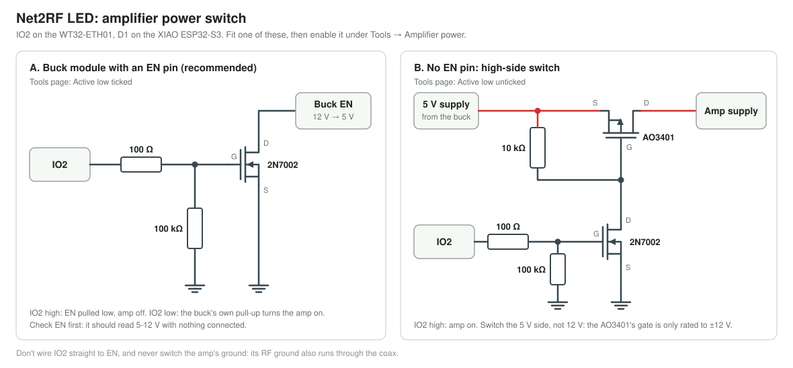

# External amplifier

An optional 433 MHz amplifier adds range beyond what the Ra-02 reaches alone. It sits between the radio and the
antenna, and has its own supply. Before adding one, try better placement: in testing, mounting the antenna high and
away from other objects made the most difference ([radio notes](../reference/radio.md#range-and-power)).

**An alternative to an amplifier:** several controllers around the area, running as a
[coverage group](../guides/multiple-controllers.md). This keeps each one at its normal power, at the cost of fewer
colour changes a second. The guide [compares the two](../guides/multiple-controllers.md#more-controllers-or-an-amplifier).

## Parts

| Part | Notes |
|---|---|
| 433 MHz amplifier | [AB-IOT-433](https://www.amazon.com/dp/B09T39P1C1), the one used here. It fits the [amp case](../../hardware/case/README.md) |
| 12 V to 5 V buck module | Powers the amp. A 3 A module with an **EN** pin also allows the power switch below |
| 12 V supply | Feeds the controller and the buck |

The amp needs no control wiring: it listens by default and switches to transmit by itself when it detects the radio's
signal. For that to be reliable the seller specifies at least 1 dBm in, which any Ra-02 power setting meets (+2 dBm is
the lowest). Its transmit gain is adjustable: set it as low as covers your area.

On the carrier board the buck takes 12 V from J6. In the amp case, the amp's OUT SMA goes through the far wall and
the buck is strapped to the tie bridge: see the [case guide](../../hardware/case/README.md#assembly).

## Licensing and legal

**An amplifier is likely to take you over the limits for unlicensed use. Check before you transmit.** This is general
information, not legal advice.

- **You are responsible.** The operator has to stay within the rules where the controller is used. The firmware doesn't
  enforce any limit, and an amplifier adds power on top of whatever it's set to.
- **United States:** unlicensed 433 MHz devices fall under FCC Part 15, which sets strict limits on field strength and
  on how often and how long a device may transmit. An amplified transmitter is unlikely to meet them.
- **Amateur radio licence:** 433 MHz is inside the US 70 cm amateur band (420-450 MHz), but a licence doesn't
  automatically cover this use. FCC Part 97 has its own rules on station identification and what may be sent, and a
  licensee must operate within them. Other countries differ.
- **Europe:** 433.05-434.79 MHz short-range devices are limited to 10 mW ERP and a 10% duty cycle.
- **Other countries:** check with your national regulator.

Use the lowest power that covers your area, and transmit only what the show needs. A strong 433 MHz signal can also
stop [car key fobs](../reference/radio.md#car-key-fobs) working nearby. More in [Legal](../reference/radio.md#legal).

## Amplifier power switch

The firmware can power an external RF amplifier up and down from **IO2**, the WT32-ETH01's only free output (on
the XIAO, D1). It's optional: until you enable it, IO2 stays the status LED's pin.

**A. Buck module with an EN pin.** The simplest switch uses the amp's 12 V → 5 V buck module:

- A small N-channel FET (2N7002 or similar): **drain to the buck's EN, source to GND, gate to IO2** through about
  100 Ω, with **100k from the gate to GND**.
- IO2 high pulls EN low and the buck, so the amp, switches off. IO2 low lets the buck's own pull-up switch it on.
- Check the module first: power it from 12 V and measure EN. About 12 V or 5-6 V means it is pulled up, so this
  circuit is right. Near 0 V means an active-low EN (LM2596 type), which needs a different circuit.

Don't connect IO2 to EN directly: EN is usually pulled up to the 12 V input, and IO2 must be low at reset for
serial flashing. The FET and its gate pull-down take care of both.

**B. No EN pin.** Switch the supply with a high-side P-FET (e.g. AO3401, 10k gate to source) whose gate a 2N7002 on
IO2 pulls low. Use it on the 5 V side: the AO3401's gate is only rated to ±12 V, which leaves no margin on a 12 V rail.
Never switch the amp's ground: its RF ground also runs through the coax.

Then, on the web UI's **Tools** page, open **Amplifier power → Switch wiring** and tick *A power switch is wired to
IO2*. Leave **Active low** ticked for circuit A, and untick it for circuit B. The **Amplifier**
switch then turns the amp on and off, and the setting is kept across restarts. Over HTTP it's `/api/amp`
([API](../reference/api.md#amplifier-power-switch)).

**Idle power-down:** set *Power down after N minutes* on the same card and the amp powers down after that long
without a transmission, then back up 0.3 s ahead of the next one. 0 keeps it on.
