# Carrier board

The WT32-ETH01 and a Ra-02 radio plug into one board, with a printed case to match. It's the tidy way to build a
controller, and runs the same firmware and pin assignment as the [DIY build](diy-build.md).

## On the board

| Feature | Details |
|---|---|
| Controller | WT32-ETH01 socket (Ethernet and Wi-Fi) |
| Radio | Ra-02 (SX1278) socket |
| Display | OLED connector J7: GND, VCC, SCL, SDA, for a [0.96" OLED](diy-build.md#parts) |
| Power | DC jack or screw terminal, 5-28 V DC, centre positive |
| Buttons | EN, BOOT and USER |

## R2.0 notes

> ⚠️ **Bridge J3 pins 9 and 10 on every R2.0 board** before fitting the radio.
>
> On R2.0 the radio's MOSI is routed to the WT32-ETH01's IO35, which is input-only and cannot drive it. A solder
> bridge (or a short wire) across **J3 pin 9 (IO12) and J3 pin 10 (IO35)**, on the underside, puts MOSI on IO12,
> which is where the firmware drives it. Without the bridge the dashboard shows the radio as **not detected**.
>
> - Bridge only those two pins. Check with a meter that neither is shorted to pin 8 (MISO) or pin 11 (radio CS).
> - IO12 is a strapping pin and must be low at power-up. Its internal pull-down does that, so put no pull-up on
>   the MOSI line.
> - R2.0's SPI routing: SCK IO15, MOSI IO35 (bridged to IO12), MISO IO14, CS IO4. The next revision moves MOSI to
>   IO14 and MISO to IO35, and the bridge will not be needed.
>
> **Fit a 10 µF capacitor between GND and RST on the right-hand header**, with the negative terminal to GND and the
> positive to RST. A non-polarised capacitor can go either way round. RST is the WT32-ETH01's EN pin.
>
> This makes reset and first power-on more stable. Without it the controller doesn't always start at power-on, and you
> have to press **EN** if the OLED stays blank. It will be added to a future revision of the board.

## Antenna

**We recommend an external antenna:** a 433 MHz SMA whip on the Ra-02's bulkhead pigtail, through the case wall and
mounted high, clear of metal. It gives the best range. The internal spring antenna suits short distances, with the
antenna hole plugged. Fit the antenna before applying power.

## Case

A printed base and snap-on lid, in two variants: one with room for an external amplifier and its buck, and a slim
one without. STLs, OpenSCAD source and fitting instructions are in [hardware/case](../../hardware/case/README.md).

## Next steps

[Flash the firmware](flashing.md): the board has pins exposed for a USB-serial adapter, or use a
[dedicated programmer](flashing.md#choosing-a-programmer). To add range, see the [external amplifier](amplifier.md) guide.

## Photos

Click a photo for the full size.

**The board:** bare, with the modules plugged in, and the back.

<a href="../images/carrier/board-parts.jpg">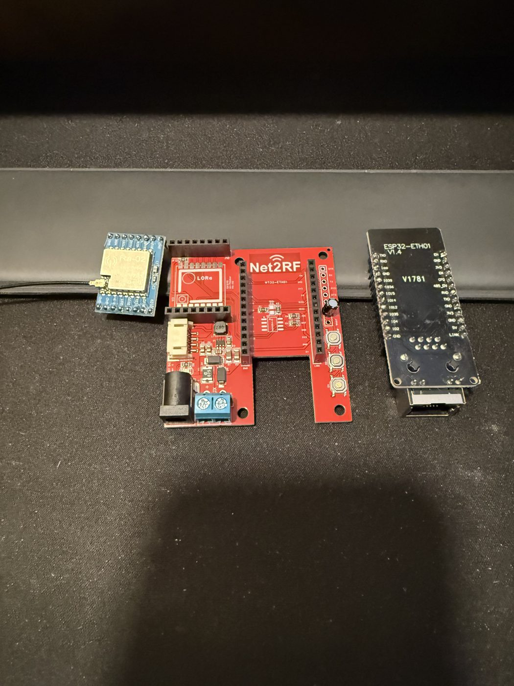</a>
<a href="../images/carrier/board-top.jpg">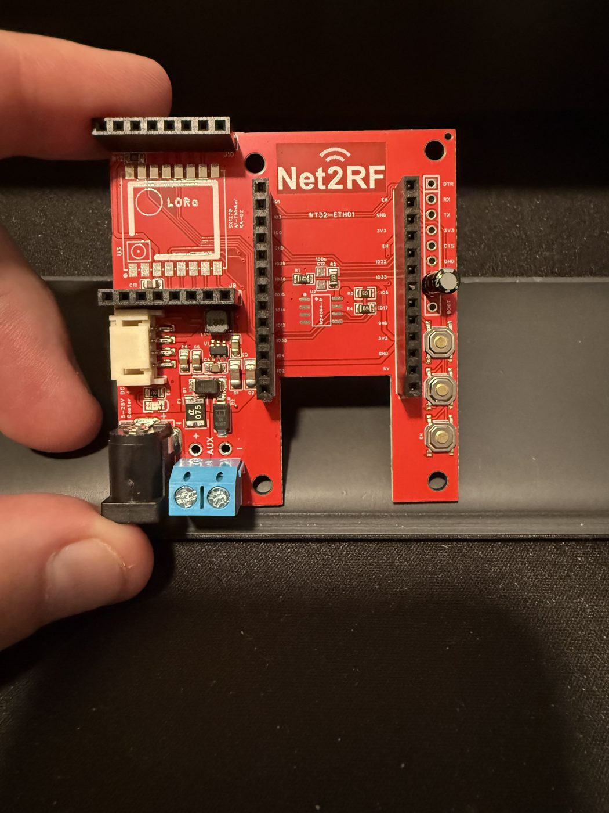</a>
<a href="../images/carrier/board-back.jpg">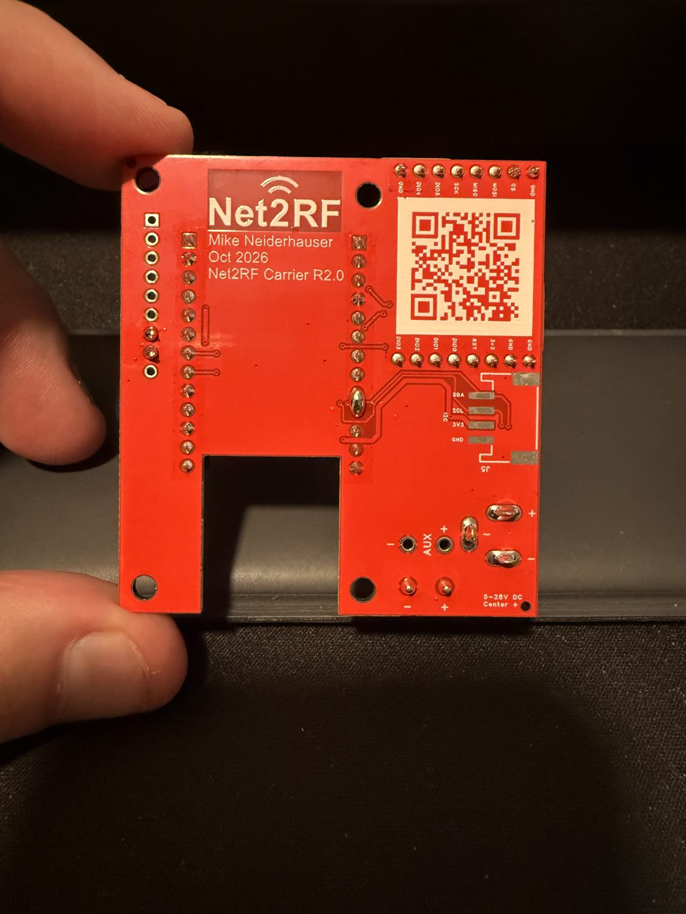</a>
<a href="../images/carrier/board-assembled.jpg">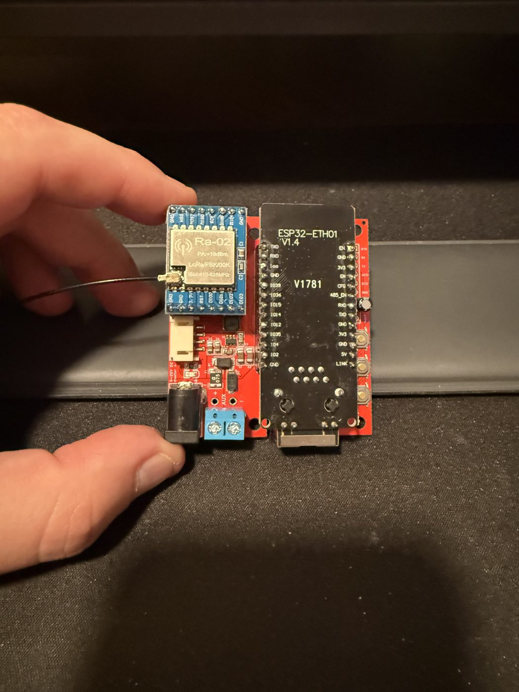</a>

**Amp case:** the external 433 MHz amplifier stands along the left wall, with its 12 V to 5 V buck at the far
wall. The amp's SMA goes through the far wall.

<a href="../images/carrier/amp-inside.jpg">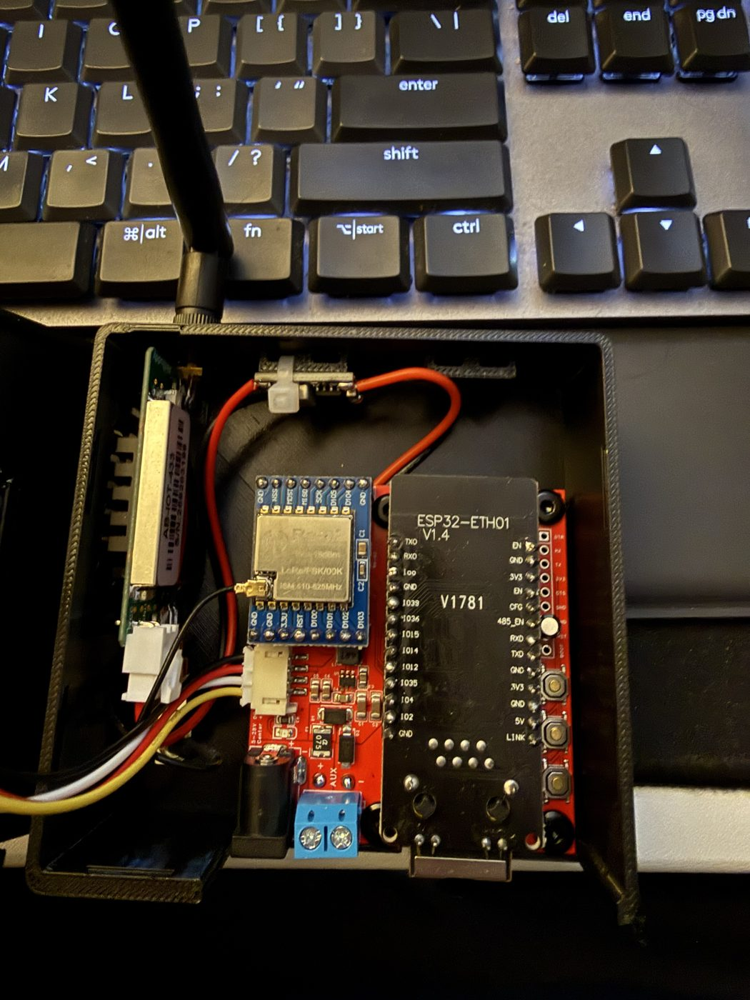</a>
<a href="../images/carrier/amp-open.jpg">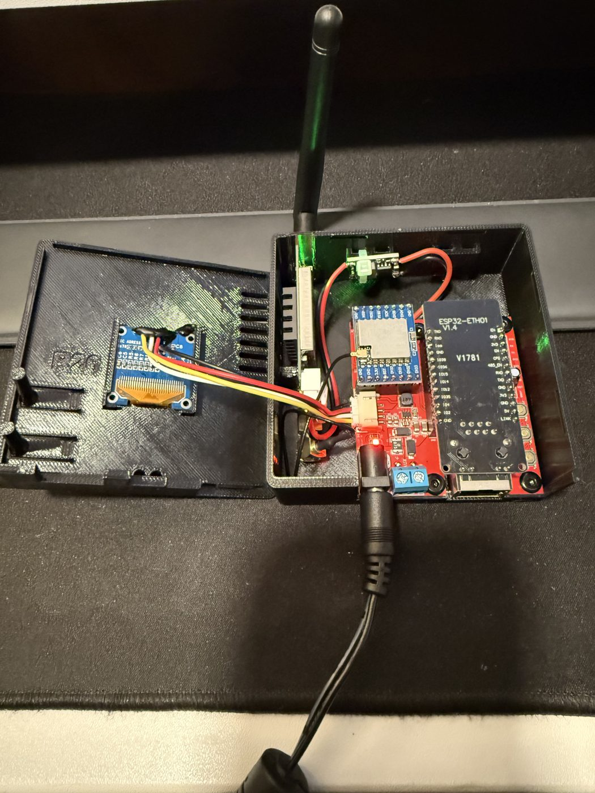</a>
<a href="../images/carrier/amp-closed.jpg">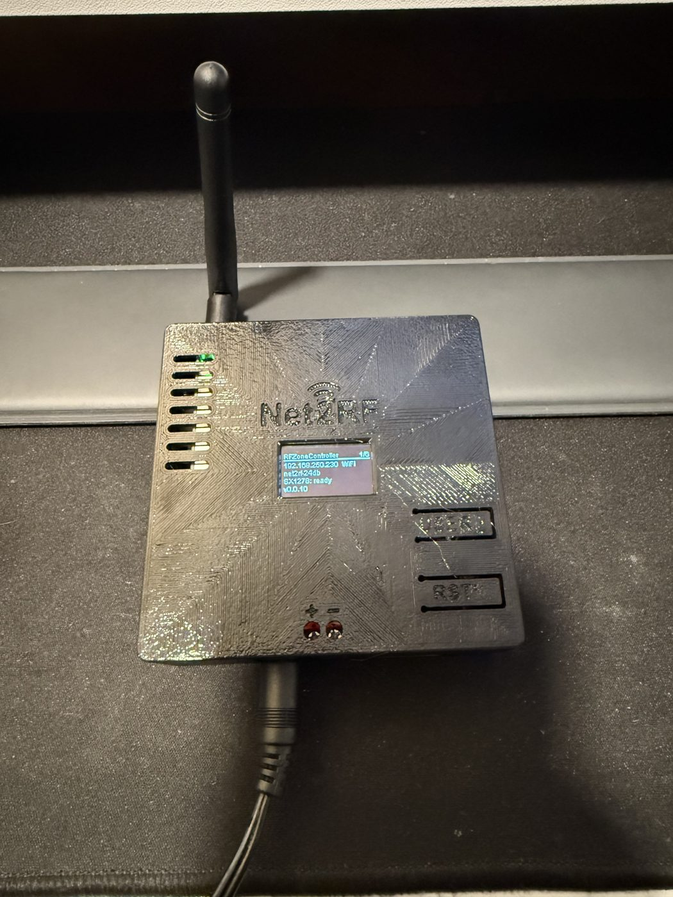</a>

**Slim case, external antenna:** the Ra-02 pigtail's bulkhead SMA through the far wall.

<a href="../images/carrier/slim-ext-open.jpg">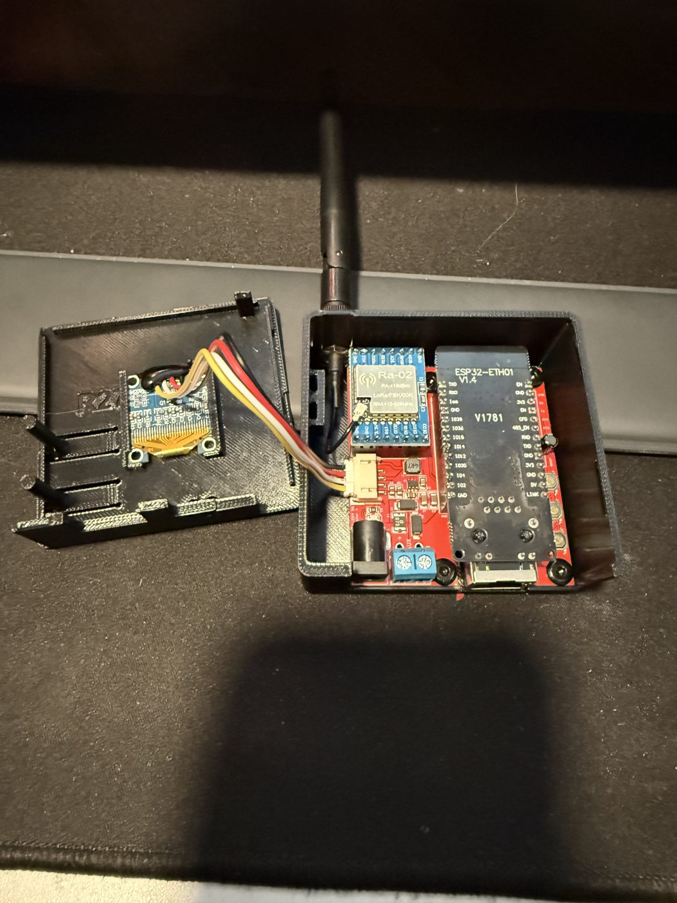</a>
<a href="../images/carrier/slim-ext-inside.jpg">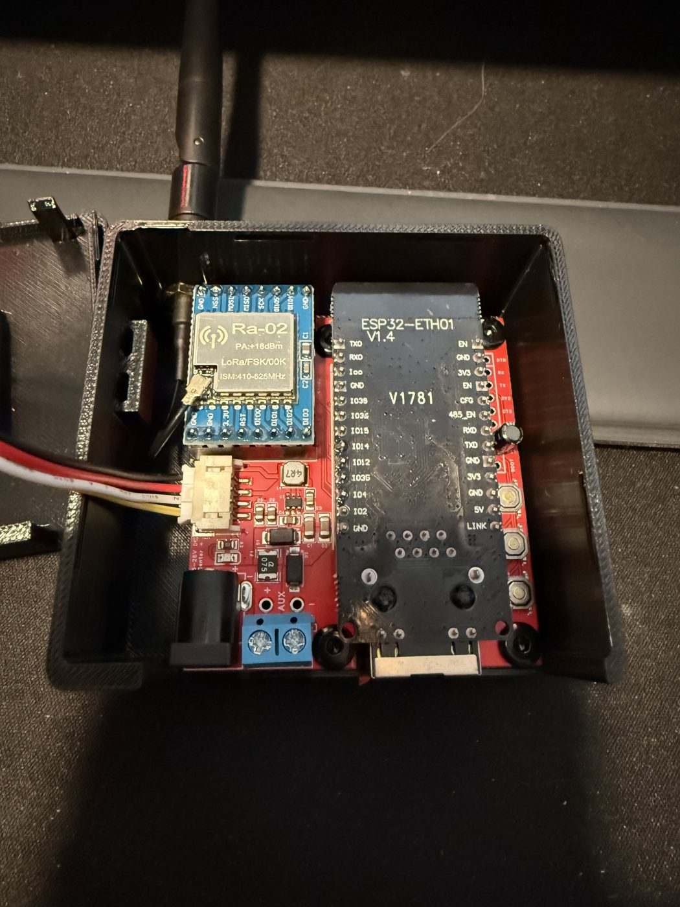</a>
<a href="../images/carrier/slim-ext-closed.jpg">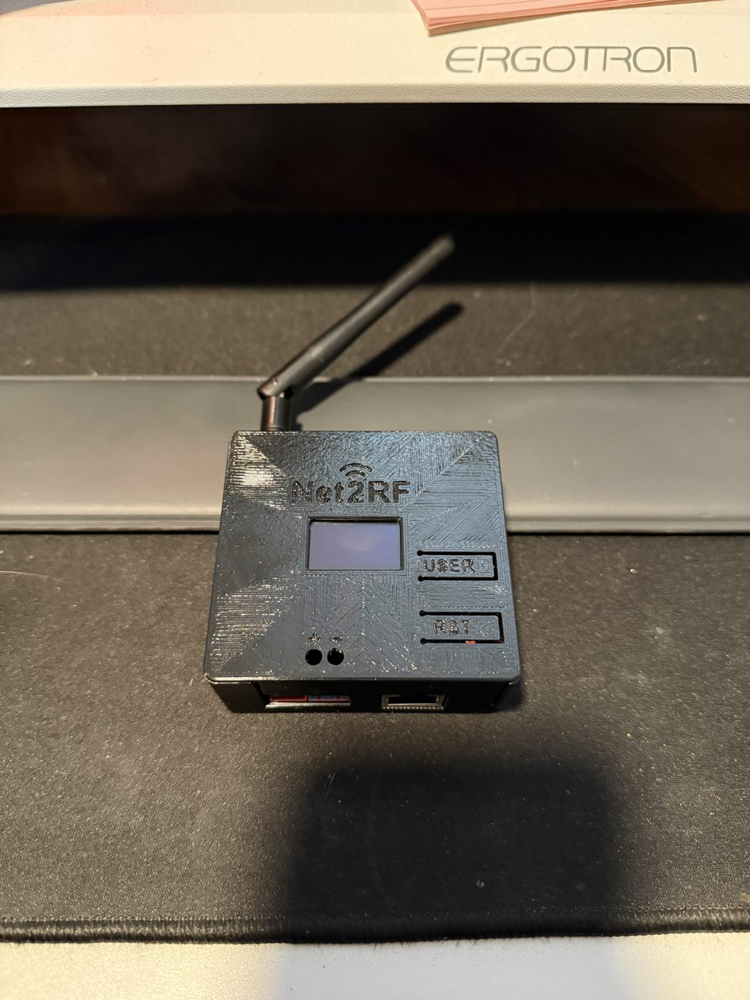</a>

**Slim case, internal antenna:** a spring antenna tied to the left wall, with the antenna hole plugged.

<a href="../images/carrier/slim-int-closed.jpg">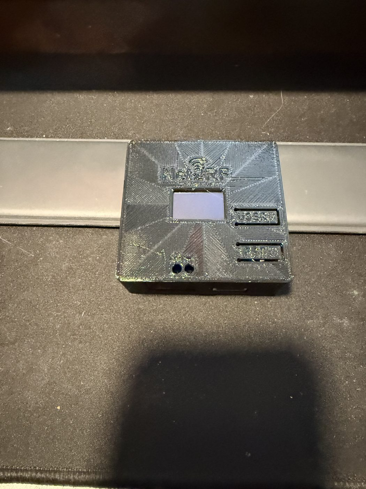</a>
<a href="../images/carrier/slim-int-open.jpg">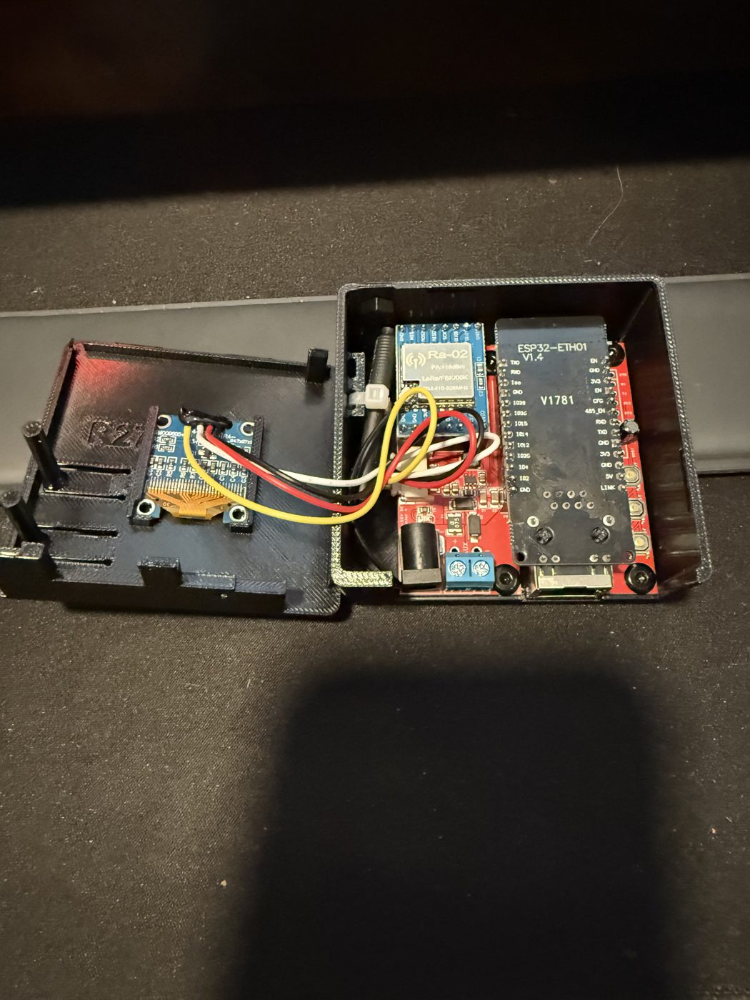</a>
<a href="../images/carrier/slim-int-inside.jpg">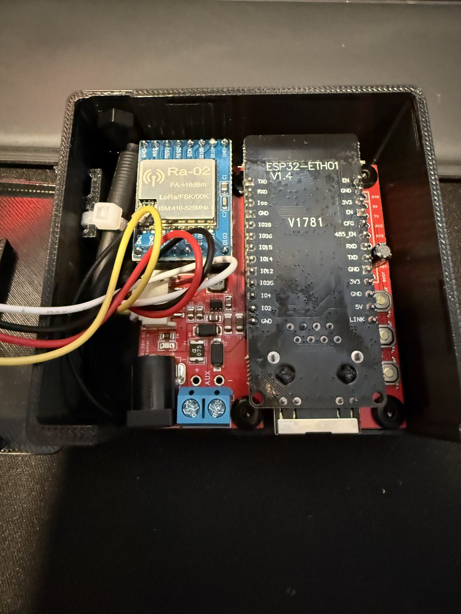</a>

