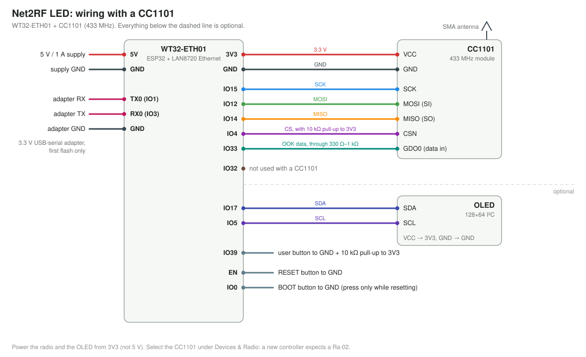
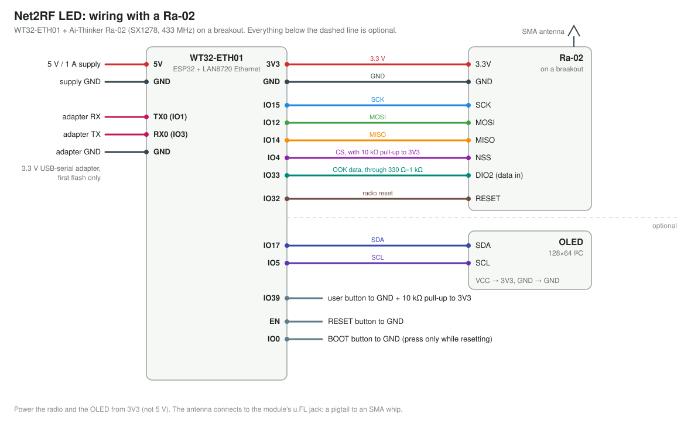

# DIY build

A WT32-ETH01 and a 433 MHz radio module, wired by hand on a breadboard or perfboard. This is how the project
started, and the cheapest way to try it.

## Parts

| Part | Notes |
|---|---|
| **WT32-ETH01** ([Amazon](https://www.amazon.com/dp/B09Z298QJQ)) | ESP32 + LAN8720 Ethernet. Power it with 5 V; its own 3.3 V regulator also supplies the radio and OLED. (Not the "WT32-ETH01-EVO", which is a different chip and pinout.) |
| **Radio, one of:** | Chosen in the web UI (*Devices & Radio → Radio module*), no recompiling. Fit only one. |
| CC1101 module, **433 MHz** | The blue 2×4-header board with an SMA jack, e.g. [AOICRIE CC1101 + antenna](https://www.amazon.com/dp/B0D2TMTV5Z). −30 to +10 dBm. Multi-band listings ("315/433/868/915") are only tuned for one band: make sure yours is 433 MHz. |
| Ai-Thinker Ra-02 (SX1278, 433 MHz) | [Ra-02 module](https://www.amazon.com/SX1278-Ai-Thinker-Wireless-Spectrum-Transmission/dp/B0CP778J3T): +2 to +17 dBm, the long-range option, and the radio on the carrier board. It has a u.FL antenna connector and 2 mm pads, so use a breakout: [ACROBOTIC Ra-02 breakout](https://www.amazon.com/ACROBOTIC-Breakout-Arduino-ESP8266-Raspberry/dp/B07MNH5W65), or [Adafruit RFM96W 433 MHz](https://www.adafruit.com/product/3073) (equivalent chip, 0.1" header). |
| 433 MHz antenna | Included with the linked CC1101. For the Ra-02: a u.FL→SMA pigtail + 433 MHz SMA whip. Mount it high. |
| 0.96" 128×64 I²C OLED (optional) | e.g. [this one](https://www.amazon.com/dp/B09T6SJBV5). 1.3" displays aren't supported. Shows IP, radio status, input rate, zone colours. Everything works without it. |
| 3 × tactile buttons ([Amazon](https://www.amazon.com/dp/B01E38OS7K)) | EN (reset), BOOT (IO0), and an optional USER button on IO39. |
| 10 kΩ resistor ([Amazon](https://www.amazon.com/dp/B0BR68QQPF)) | Pull-up for the USER button (IO39 has no internal pull-up). |
| 330 Ω–1 kΩ resistor | In series with the radio data line (IO33). Cheap insurance against two outputs fighting. |
| 3.3 V USB-serial adapter | FT232 / CH340 / CP2102 "FTDI" board, e.g. [this FT232RL USB-C one](https://www.amazon.com/dp/B0DDGLRY1D), for the first flash only. Set it to **3.3 V**. |
| 5 V / 1 A supply | The controller draws ~400 mA worst case. |
| Breadboard ([Amazon](https://www.amazon.com/dp/B07LFD4LT6)) and Dupont jumper wires ([Amazon](https://www.amazon.com/dp/B01EV70C78)) | For a solderless build like the prototype. |

**Avoid** UART "LoRa" modules (EBYTE E32/E22, DL-LL02): they can't send raw OOK.

Links are examples of matching parts, not endorsements. Listings change, so check the band (433 MHz) before buying.

## Pinout

Fit one radio. Both use the same pins, and you choose yours in the web UI.

**With a CC1101:**

**With a Ra-02:**

The WT32-ETH01 silkscreen labels some pins by their original serial-bridge function; both names are given below.

### Radio (fit one; both use the same pins)

A new or reset WT32-ETH01 controller expects the Ra-02 (SX1278); pick CC1101 under Settings > Radio if that is
what you fitted. The XIAO ESP32-S3 build starts on CC1101.

| WT32-ETH01 pin | Silkscreen | Function | CC1101 | Ra-02 (SX1278) |
|---|---|---|---|---|
| 3V3 | 3V3 | Power | VCC | 3.3V |
| GND | GND | Ground | GND | GND |
| IO15 | IO15 | SPI SCK | SCK | SCK |
| IO12 | IO12 | SPI MOSI | MOSI (SI) | MOSI |
| IO14 | IO14 | SPI MISO | MISO (SO) | MISO |
| IO4 | IO4 | Radio CS (10 kΩ pull-up to 3V3) | CSN | NSS |
| IO33 | 485_EN | OOK data (via 330 Ω–1 kΩ) | GDO0 | DIO2 |
| IO32 | CFG | Radio reset | not used | RESET |

Wired by hand, take MOSI straight to IO12.

The firmware checks the CC1101's GDO0 → IO33 connection at boot. A broken data wire shows as **data line fault**
on the dashboard, instead of the radio silently keying up with nothing on it.

### Everything else

| WT32-ETH01 pin | Silkscreen | Function | Connection |
|---|---|---|---|
| 5V | 5V | Power in | 5 V supply |
| IO5 | RXD | I²C SCL | OLED SCL (optional) |
| IO17 | TXD | I²C SDA | OLED SDA (optional) |
| IO39 | IO39 | USER button (optional) | button to GND, 10 kΩ pull-up to 3V3 |
| IO1 | TXD0 | Serial TX | adapter **RX** (first flash) |
| IO3 | RXD0 | Serial RX | adapter **TX** (first flash) |
| EN | EN | Reset | button to GND |
| IO0 | IO0 | BOOT | button to GND |

- **IO12** carries MOSI and is a strapping pin: it must be low at boot, which its internal pull-down gives it.
  Put no pull-up on the MOSI line.
- **IO2** drives the WT32-ETH01's onboard LED (the status LED). The only other thing to wire to it is an
  [amplifier power switch](amplifier.md#amplifier-power-switch), with a pull-down: a pull-up on IO2 breaks serial flashing.
- **IO0** is also the Ethernet 50 MHz clock once running. Only press BOOT while resetting, and keep wiring
  on it short.
- The OLED pins are labelled `RXD`/`TXD`, not `TXD0`/`RXD0`, which is easy to mix up. If SDA and SCL are
  swapped, the firmware detects it and carries on.

## Power budget

| Load | Current |
|---|---|
| ESP32 + Ethernet | ~250 mA peak |
| Ra-02 transmitting at +17 dBm | ~90 mA |
| CC1101 transmitting | ~30 mA |
| OLED | ~20 mA |

About 400 mA worst case, within the WT32-ETH01's regulator. Use a 5 V / 1 A supply.

## Next steps

[Flash the firmware](flashing.md), then follow the [show setup guide](../guides/show-setup.md).
