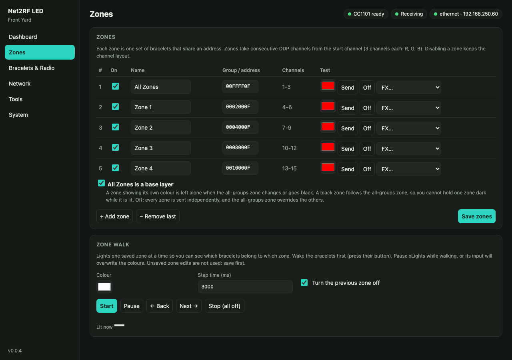

# Adding devices to your show

You already have a light show running from xLights (or Falcon Player). This guide adds the audience's LED
devices, light sticks or pucks to it as one more prop: the controller joins your show network like any other
controller, and each group of devices becomes a single pixel you sequence alongside everything else.

**Before you start:**
- a controller built and flashed ([build guide](../build/README.md));
- a couple of devices to test with;
- access to your show network and xLights layout.

## 1. Put the controller on your show network

(Details: [user guide, Connecting](user-guide.md#connecting).)

- **Ethernet (recommended):** plug it into the same network as your other controllers, and open
  `http://net2rf.local/` (or the IP from the OLED or your router).
- **Wi-Fi:** if it can't find a network it opens its own, **NET2RF-XXXX** (password `net2rf1234`). Join it; the
  setup page opens. Enter your show Wi-Fi under **Network** and save, and the controller reboots onto it.
  The ESP32 only does 2.4 GHz.

Check the dashboard: the radio should read **CC1101 ready** (or SX1278). *Not detected* means wiring or power to the
radio, or the wrong module selected under **Devices & Radio**.

Then give it a **static IP** (or a DHCP reservation) under **Network**, so xLights always finds it like your
other controllers, and optionally an **admin password** under **System**.

## 2. Find out which devices you have

1. Switch a device on. Give it about 10 seconds to start, and if it has a button, press it: Banana Ball bracelets
   ignore the radio until they're woken this way. Hold it a few metres from the antenna.
2. **Tools → Which protocol is my device? → Start test.** The controller alternates:
   - **green** = protocol 1 (Wally's Lights, LedGiftSupplier.com)
   - **red** = protocol 0 (Shenzen New Dody, including Banana Ball bracelets)
3. Click the matching **use protocol** button: every zone switches to that protocol.

**Both kinds of devices?** Under **Devices & Radio → Device protocols**, pick **Both** (every zone sends
each change on both protocols, so any device in its group follows it) or **Per zone**, then choose each zone's
protocols on the **Zones** page, for example protocol 0 bracelets in one zone and protocol 1 pucks in another.
Only the protocols you pick are transmitted: a protocol 0-only setup never spends airtime on protocol 1. Every zone
keeps an address in both protocols, so switching never loses one.

Nothing lights? Press the device's button if it has one (it may have gone back to sleep), check its battery, move
closer, and raise **TX power**.

## 3. Decide how the devices fit into the show

Every device in a **zone** shows the same colour, and each zone is one pixel in xLights. Choose how many you
need:

- **One look for the whole audience:** a single zone that reaches every device. The simplest way to start:
  use only the first zone, **All Zones**.
- **Sections:** one zone per group of devices, for example left and right of the yard, or kids' and adults'
  devices. It only works if your devices come in different groups. Find out with the steps below.

A new controller starts with every zone on protocol 1, and five zones: **All Zones** (every device), then **Zone 1** to
**Zone 4** (groups 1 to 4). Remove the ones you don't need on the **Zones** page; *Add zone*
continues with the next group.

#### All Zones as a base layer (protocol 0)

With **All Zones is a base layer** ticked on the Zones page, the zone addressed to every group (All Zones) and
the single-group zones work as layers, like a model group under its models in xLights:

- **A zone with its own colour sits on top.** While Zone 2 shows blue, changes on All Zones don't reach its
  devices: the controller addresses "every group except Zone 2's" in one packet. Nothing flashes, and it
  costs no extra airtime.
- **A black zone follows All Zones.** A zone with no effect shows whatever All Zones shows. When a zone's own
  effect ends, its devices go to the current All Zones colour, or off if All Zones is black.
- **All Zones going black** switches off only the devices that were following it.
- **One packet per colour, not per zone.** Zones that change to the same colour at the same moment share a
  single transmission, and a zone that wants the colour All Zones already shows needs none. Fifteen zones
  turning red together cost one RF update (about 140 ms), not fifteen.

| In the sequence | Devices show |
|---|---|
| All Zones red, zones empty | everyone red |
| All Zones red, Zone 2 blue | Zone 2 blue, everyone else red |
| All Zones changes to green while Zone 2 is blue | Zone 2 stays blue, everyone else green |
| All Zones effect ends while Zone 2 is blue | Zone 2 stays blue, everyone else off |
| Zone 2's effect ends while All Zones is green | Zone 2 turns green |

What to know:

- **You can't hold one zone dark while All Zones is lit:** black on a zone means "follow All Zones".
- **Default:** on for a new or factory-reset controller. A controller that already had saved settings keeps the
  old behaviour until you tick the box.
- **Off:** every zone is sent independently. A colour on All Zones then overrides the single-group zones, and
  an All Zones effect that ends darkens a zone holding a steady colour, so sequence one or the other at any
  moment.
- **Protocol 0 only.** Protocol 1 addresses one group or all of them and can't leave groups out.
- Zones other than All Zones shouldn't overlap each other (two zones containing the same group).

### Finding groups on protocol 1

Every device belongs to a **group**, and group **0** reaches all of them. Find each device's group with **Tools →
Address probe** (protocol 1, field *Group (byte 1)*, mode *Sweep*, 1 → 20), pressing **★ Device reacted** when it
lights. Then add a zone per group on the **Zones** page and check each with **Send**.

Avoid mixing a group-0 zone with specific groups unless you mean it: every change on the group-0 zone overrides
all of them (the Zones page warns you).

### Finding groups on protocol 0

The default address `00FFFF0F` reaches every device. Bytes 2-3 (`FFFF`) are a 16-bit **group mask**,
one bit per group. The two devices tested so far are on groups 2 (`0004000F`) and 3 (`0008000F`); yours may be
on others.

1. **Tools → Address probe:** protocol 0, field *Mask bytes 1-2*, mode *Walk single bits*, step time **3 s** or
   more. It steps through groups 0 to 15, showing each address and its group. Wake the device first, then
   press **★ Device reacted** when it lights. The mark records the address and group on screen, so a slow
   press can land on the next step; repeat to be sure.
2. Add a zone with that address (`00` + mask + `0F`), save, and check it with the **Zone walk** on the Zones
   page. Combining bits (`000C000F` = groups 2 and 3) addresses several groups at once.

Please report what your devices answer to: it's how this gets confirmed.

## 4. Check the range where the audience will be

1. Mount the antenna where it will live during the show: high, clear of metal, with a view of where people stand.
2. **Dashboard → Test mode → Cycle R/G/B/W.**
3. Walk the edges of the audience area with a device. It should change colour every 2 seconds.
4. Lower **TX power** (Devices & Radio) until the far edge just starts to miss, then go back up a step or two.
   Less power means fewer problems for your neighbours' car key fobs.
5. Switch test mode **Off**.

## 5. Add it to xLights

Treat the controller like any other Ethernet controller in your setup. **Tools → xLights setup** on the controller
lists the exact settings for its current zones.

### The controller

1. **Controllers → Add E1.31/Artnet/DDP:** protocol **DDP** and the controller's IP. Leave **Keep Channel Numbers**
   unticked: with it on, xLights sends absolute show channel numbers and the controller ignores them (the dashboard
   then shows *Wrong channels*).
2. **Vendor / model:** pick **WLED / WLED / Generic ESP32**. It works with xLights as shipped and keeps the controller
   visualiser. It shows 8 ports: use **port 1** and leave the others empty. A one-port **Net2RF / Net2RF LED**
   definition is also available: see [`tools/xlights`](../../tools/xlights/README.md) (not yet tested).
3. **Channels per packet:** leave the default. The controller uses only a handful of channels, so each frame fits in
   one packet.

For **E1.31** instead of DDP, use the universe set under *Devices & Radio*.

### The model

Use the ready-made models in [`tools/xlights`](../../tools/xlights/README.md). There are no channels to work out:

| Model | Zones | Channels |
|---|---|---|
| [`Net2RF_All_plus_4.xmodel`](../../tools/xlights/Net2RF_All_plus_4.xmodel) | All Zones + Zone 1-4, a new controller's five zones | 15 |
| [`Net2RF_All_plus_15.xmodel`](../../tools/xlights/Net2RF_All_plus_15.xmodel) | All Zones + Zone 1-15, the maximum | 48 |

1. **Layout → Import → Custom model**, and pick the file.
2. Put the model on **port 1** of the controller, as the only model.
3. **Upload Output** sets the controller's number of zones to match. If the controller has an admin password, upload
   is refused, because xLights has nowhere to enter it. The colour order, the device protocol and each zone's group
   stay as set on the controller.
4. Sequence its submodels: **All Zones**, **Zone 1**... and **Zones 1-N** (every single zone at once). Use solid
   colours on the whole model: an effect that spreads across it gives each zone a different colour.

### Sequencing the model

Sequence the model on its own, with held, solid colours. It's tempting to add it to an existing group such as your
floods so it follows along, but pixel-style effects are too busy for the radio: a flood sequence with fades and
strobes measured 19% airtime on average and over 40% in bursts, one 94 ms packet per colour step. To keep changes
down, add it to a **Devices** group of its own for moments that use it.

### Falcon Player

If FPP plays your show, push the updated output configuration to it as you do for your other controllers (for example
with *FPP Connect*). FPP then sends DDP to the controller, which also appears on FPP's MultiSync page.

### Check it

Play a sequence. The dashboard shows the input frame rate climbing and each zone's colour following.

### Other input modes

Only needed if you aren't using the ready-made model.

- **Pixel mode, models by hand:** 3 channels per zone. Use a *Single Line* model with 1 node per zone, or a 1-node
  *Single Line* per zone at start channels 1, 4, 7..., string type *RGB Nodes* (matching the colour order setting).
  Chain the models on **Pixel Port 1** so xLights assigns the channels:

  | Model | Chained after | Channels | Controller zone |
  |---|---|---|---|
  | `RF-All` | (first on port 1) | 1-3 | All Zones |
  | `RF-Zone1` | `RF-All` | 4-6 | Zone 1 |
  | `RF-Zone2` | `RF-Zone1` | 7-9 | Zone 2 |
  | `RF-Zone3` | `RF-Zone2` | 10-12 | Zone 3 |

- **DMX mode (4 channels per zone):** a *DmxFloodlight* per zone (start 1, 5, 9...) with Red 1, Green 2, Blue 3.
  Channel 4 is an effect channel for protocol 0: 0-19 follow RGB, 20-39 off, 40-59 **fade in** to the last colour,
  60-79 **fade out** to black. Colours are tested; the fade channel values aren't yet.
- **Vendor mode (5 channels per zone, not yet tested):** the vendor DMX transmitter's own layout, so an existing DMX
  setup for that transmitter should keep working. Per zone, a 2-channel DMX model at the zone's start channel with
  channel 1 = 85 (transmit) and channel 2 = group, plus a 1-node *Single Line* at start + 2 for the colour.

## 6. Sequencing tips

- **Existing sequences:** devices only light where an effect covers their model, either through a group you
  added them to or directly. Render, play, and see which songs need a touch-up.
- **Speed:** the radio manages roughly **5-10 colour changes per second** across all zones, ~100-150 ms behind the
  music. Bold, slow effects (On, Color Wash, Fill, slow Marquee) read best; fast twinkles and sparkles turn into
  random flicker. Effects that look great on pixel props may be too busy for devices.
- **Colours:** protocol 0 bracelets have **10 fixed colours** (red, green, blue, pink, white, yellow, violet,
  orange, indigo, cyan); anything else snaps to the nearest. Fades become steps.
- **Black = off:** to blank the devices, set their pixel to black, or leave a gap with no effect (xLights
  outputs black there). Protocol 0 sends its real *off* command for anything darker than the off threshold
  (16/255 by default), so a fade snaps off near the end rather than dimming smoothly. It's sent once; the
  devices stay dark until the next colour. (*RF output off* and vendor mode's channel 1 ≠ 85 stop
  transmitting instead, and the devices **hold** their last colour.)
- **Moments:** devices have the most effect at big beats, drops and finales. Constant changes add airtime
  without adding much.

## 7. Show night

- **All off** on the dashboard blanks every device at once.
- **Disable output** stops all RF without touching xLights; turn it back on and the current colours are re-sent.
- If the show stops sending for 5 minutes, the devices blank themselves (**Blank after no input**).
- Banana Ball bracelets turn red by themselves after ~20 minutes idle; the next colour change brings them back.
- Handing devices out? Switch them on 10 seconds ahead, and press their buttons if they have them.
- More than one controller? Read [Using several controllers](multiple-controllers.md) first.
- Home Assistant can watch `/api/stats` and switch output on a schedule: see [Home Assistant guide](home-assistant.md).
