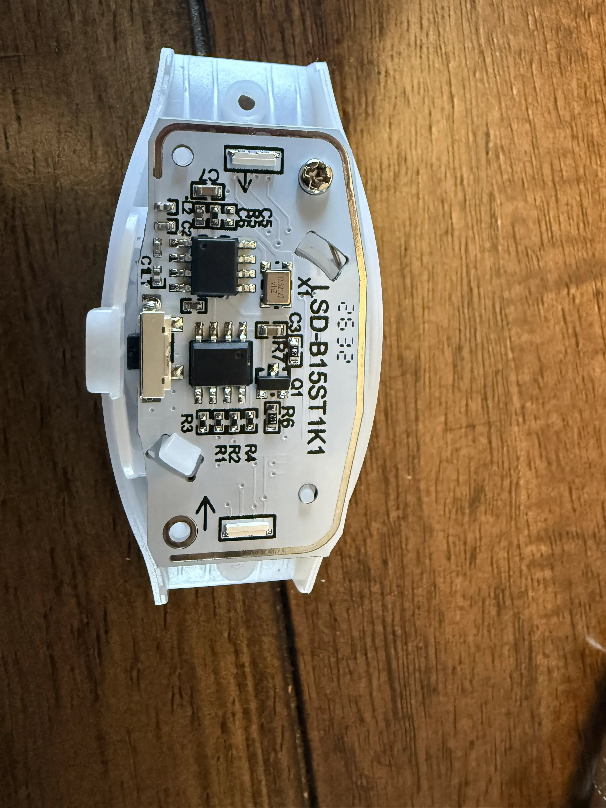

# Compatibility

What has actually been run against real hardware, and what's only supported on paper. If you try something
that isn't listed, please [report it](#reporting-a-device): every report widens the list.

**Status key:**
- ✅ **tested:** run on real hardware.
- 🧪 **supported, untested:** implemented, but not yet run on real hardware.
- ❔ **unknown:** not checked yet.

## RF devices (bracelets, sticks, pucks)

### ✅ Wally's Lights RF products (protocol 1)

Wally's Lights' RF range (hats, pucks, bracelets and light sticks, sold with a "DMX to RF" transmitter) uses
**protocol 1**, the same protocol as the LedGiftSupplier devices above.

**Tested: wristbands, pucks, a wand and the Santa hat.** All four follow the controller from xLights and FPP, by
group and all together, with the sync timing the firmware sends as it is. The notes below are from the bracelets.

- **Power switch, slow start.** The bracelet has a power switch (no button to press to wake it, unlike the
  protocol 0 bracelets). After switching on it takes about 10 seconds before it follows the controller. The
  cycle test sends a new colour every 2 seconds, so that is the bracelet starting up, not a wait for the next
  packet: switch them on well before they are needed. Once running it kept up with the cycle test, so it looks
  like a slow start, not a receiver that only listens now and then.
- **Groups work, and the vendor's zone is the group code.** The bracelets tested are the
  [5 Pack RF Bracelets (Zone 1)](https://wallyslights.com/collections/dmx-products/products/5-pack-rf-bracelets).
  They respond to group 0 (everyone) and to group 1: the vendor's "Zone 1" is group 1, and group 0 is the
  broadcast, as the protocol notes said. The zone is part of the product (it is sold by zone), so a bracelet's
  group is fixed. Other zones have not been seen yet.
- **From the product page:** 2 RGB LEDs, two CR1632 cells (replaceable) with a stated life of 5 to 8 hours.
  The vendor recommends sequencing them like a flood light and warns of delay with fast colour changes and
  strobes, which matches what this controller's airtime measurements say.
- **Full-range colour, with flicker when dim.** Red, green, blue and white each dim through the whole range
  (tested from 255 down to 1), so the 8-bit colour bytes are honoured. Colour changes at full brightness are
  clean, whether each packet is sent once or 3 times. At low levels the bracelet visibly flickers, also while
  a dim colour is simply held with nothing on air: that is the bracelet's own dimming, not the controller.
  Prefer bright colours with these; avoid slow fades down to black.

Only the receiving products are here, not the vendor's transmitter.

### 🧪 LedGiftSupplier.com bracelets and light sticks (protocol 1)

Supported from the protocol as decoded from the Flipper Zero app and the vendor's DMX transmitter guide, with the
colour and checksum bytes matched to off-air captures of the vendor's transmitter: full 8-bit RGB, group codes,
group 0 = all. Not yet tested with a LedGiftSupplier-branded device; Wally's Lights devices, which use the same
protocol, follow it (above). This is the protocol the vendor's "DMX to RF transmitter" kits
use.

### ✅ Banana Ball bracelet (protocol 0)

| | |
|---|---|
| Where from | LED bracelet from a Banana Ball game |
| PCB marking | `SD-B15ST1K1` |
| Radio | 433 MHz receiver; 13.52127 MHz crystal (`X1`); loop antenna around the board edge; main chips unmarked |
| Controls | push button |
| Protocol | **0, Shenzen New Dody** (lights red in *Tools → Which protocol is my device?*) |
| Colours | The protocol's 10 fixed colours |
| Effects | **Fade in** (`05 AA`, back to the last colour) and **fade out** (`06 AA`, to black) work. The app's third effect packet does nothing. |
| Address | Two bracelets tested: one on **group 3** (`0008000F`), one on **group 2** (`0004000F`). Both answer the all-groups address `00FFFF0F`. Other bracelets may be on different groups. |
| Tested with | WT32-ETH01 + CC1101, xLights over DDP in pixel mode: follows the sequence |

What to know:
- **Wake it first.** It ignores the radio until its button is pressed.
- **Latches.** It holds the last colour (or off) until it gets a new command.
- **Idle red.** About 20 minutes after the last command it turns red by itself, but keeps listening. The next
  colour change brings it back. It's not yet known whether this is idle or low battery, and whether it sleeps
  later.
- **Two units tested,** on groups 2 and 3. Bracelets from the same event can be on different groups. Use the
  address probe to check yours.

### ❔ Other products

Other RF pucks, wands, hats and the like may use one of these two protocols or something else. Try *Tools →
Which protocol is my device?* and report the result.

## Controller hardware

| Part | Status | Notes |
|---|---|---|
| WT32-ETH01 (ESP32 + LAN8720) | ✅ | Ethernet and Wi-Fi both used. Not the WT32-ETH01-EVO (different chip and pinout). |
| Seeed XIAO ESP32-S3 | 🧪 | Wi-Fi only; own build (`xiao-esp32s3`), wiring in [XIAO guide](../build/xiao-esp32s3.md). |
| CC1101 433 MHz module, blue 2×4 header + SMA (AOICRIE, see [parts](../build/diy-build.md#parts)) | ✅ | Reports chip version `0x14`; data-line self-test passes; drives the Banana Ball bracelet. |
| Ai-Thinker Ra-02 (SX1278) on a breakout | ✅ | On the carrier board R2.0 (needs the J3 bridge, see [carrier board guide](../build/carrier-board.md)). |
| 0.96" I²C OLED, SSD1306 or SSD1315 chip | ✅ | Including detection of swapped SDA/SCL. The 24.7 x 27 mm board fits the case's small OLED lids. Its header is GND, VCC, SCL, SDA, as J7. |
| 3.3 V USB-serial adapter (FTDI-style) | ✅ | First flash; updates are then over the network. |
| Carrier board R2.0 | ✅ | WT32-ETH01 + Ra-02, in both printed cases. Bridge J3 pins 9-10, and fit 10 µF from RST to GND so it starts at power-on ([carrier board guide](../build/carrier-board.md)). |

## Software and features

| | Status |
|---|---|
| xLights → DDP, pixel mode | ✅ (controller profile WLED / WLED / Generic ESP32, Keep Channel Numbers off) |
| DDP, DMX mode | ✅ colour (with a DDP test sender); 🧪 the fade channel values (the fades themselves work when sent directly) |
| DDP, vendor mode | 🧪 |
| E1.31 (sACN) | ✅ unicast (other universes ignored); 🧪 multicast |
| xLights *Upload Output* (zone count) with the All + 15 and All + 4 models | ✅ from xLights 2026.17, WLED / Generic ESP32 profile |
| xLights *Upload Input* | ✅ |
| The Net2RF controller definition | 🧪 |
| Base layer and same-colour merging (protocol 0) | ✅ packets checked on the controller; bracelets on groups 2 and 3 |
| FPP discovery ping (found by FPP / xLights) | ✅ xLights 2026.17 *Discover* adds it by hostname; ✅ listed on FPP's MultiSync page |
| Falcon Player (FPP) as the show player | ✅ |
| Web UI, setup hotspot, Wi-Fi join, firmware update with rollback | ✅ |
| Test mode, zone walk, address probe, group tester, range walk | ✅ |
| Range across a yard | ✅ Ra-02 on the carrier board, with and without the external amplifier. Mount it high and away from things. |
| Reset settings, reset network, factory reset (System page and USER button) | ✅ |
| Receiver mode | ✅ Ra-02 on the bench, both protocols, no bad frames: use *near* or *wide* with a transmitter this close; 🧪 CC1101, across a yard |
| Fade and flicker test modes, started at power-up | ✅ run on the controller, and restarted by themselves after a power cut; ✅ fade on Wally's Lights pucks; 🧪 flicker on devices, and both on bracelets |
| Amplifier power switch (`/api/amp`), idle power-down | 🧪 no switch wired yet |
| Power-up test mode gives way to live input | ✅ with a real show over DDP on a WT32-ETH01: devices followed it, and the mode came back when it stopped |
| Saved fade presets; power-up mode, amp and presets in the settings export | ✅ API, export, import and reboot on a WT32-ETH01 |
| Several controllers (live list, `net2rf.local` election) | ✅ two real controllers |
| Coverage group | ✅ two WT32-ETH01 controllers over Wi-Fi: joined and synced in seconds, clock error 3-8 ms, no missed changes, and devices followed a real show; 🧪 three or more controllers |
| Listen before transmit | ✅ two Ra-02 controllers in range: a third in receiver mode heard 59-75% of changes with it on, 6-12% with it off |
| Home Assistant examples | 🧪 |

## Reporting a device

Open an issue with:

1. **Photos** of the device, outside and the PCB (markings, crystal, chips), like the one above.
2. **Where it came from:** event, vendor, listing.
3. **Protocol:** what *Tools → Which protocol is my device?* shows (red = 0, green = 1, nothing).
4. **Address:** what *Tools → Address probe* finds (see [show setup guide](../guides/show-setup.md#3-decide-how-the-devices-fit-into-the-show)).
5. **Behaviour:** does it need a button press to listen, what does it do when idle, and how long does it last on
   its batteries?
6. Your controller hardware and firmware version (*System* page).
