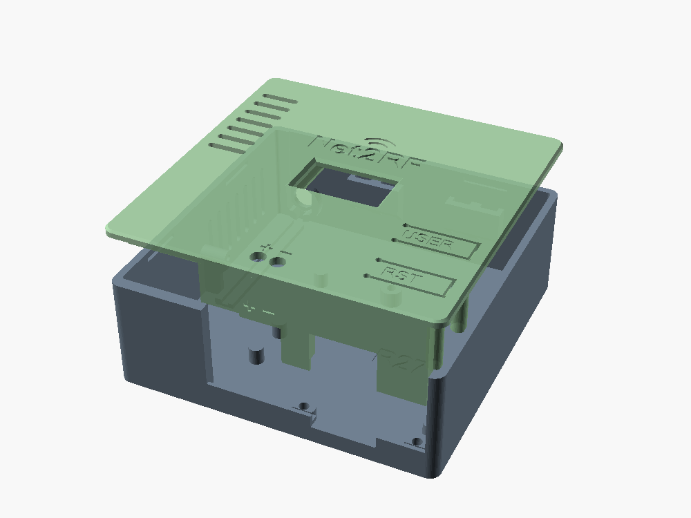
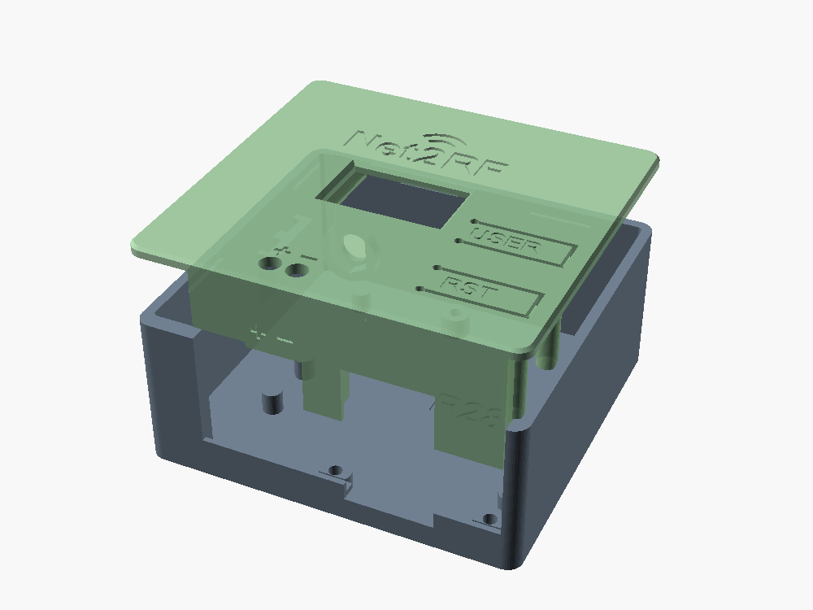
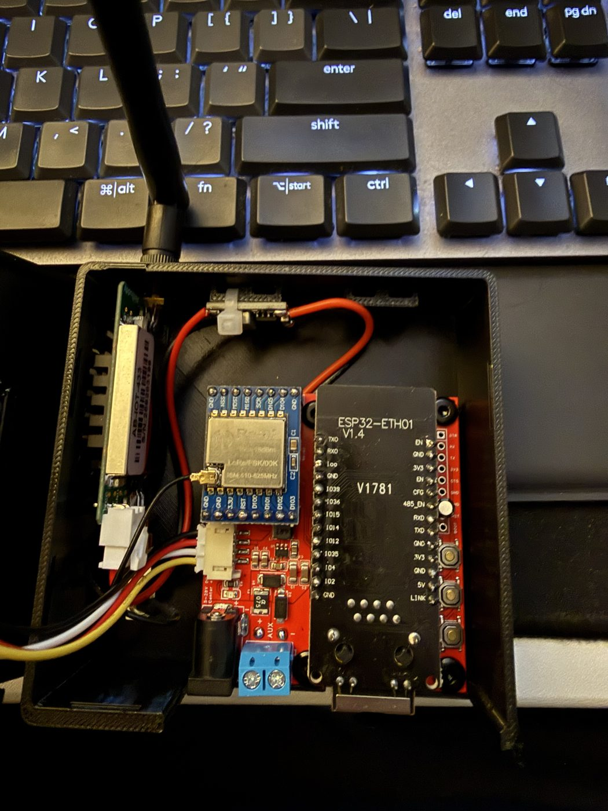
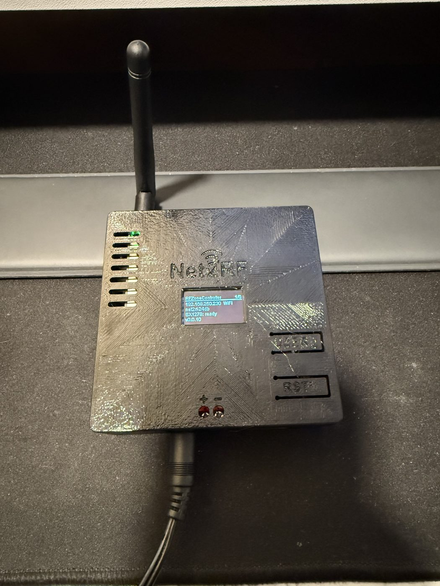
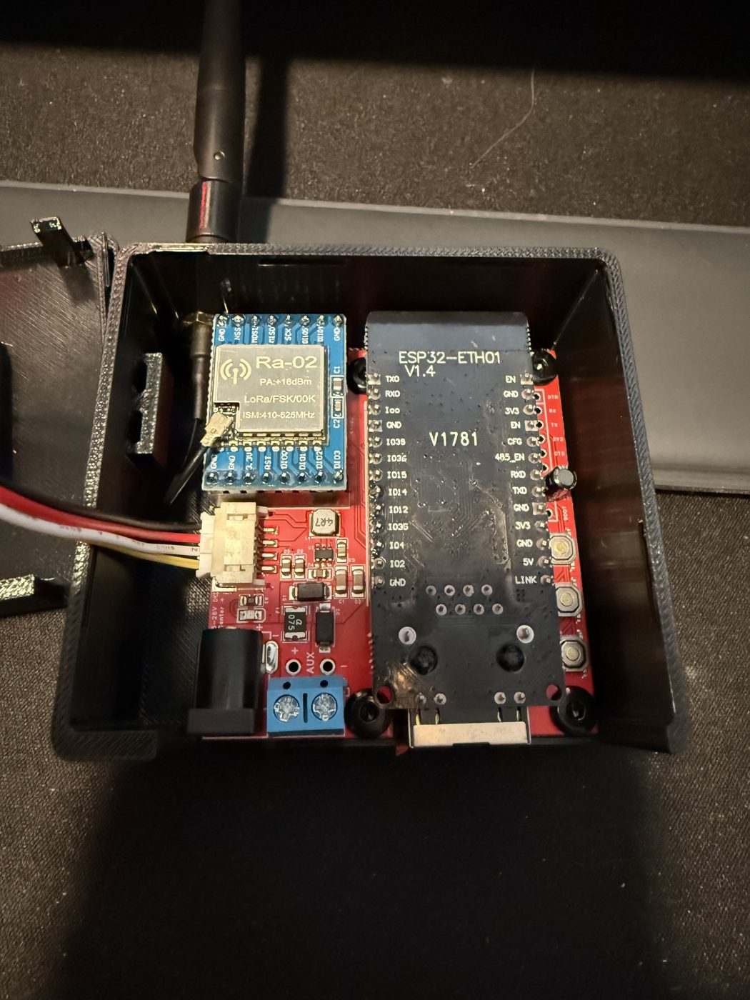
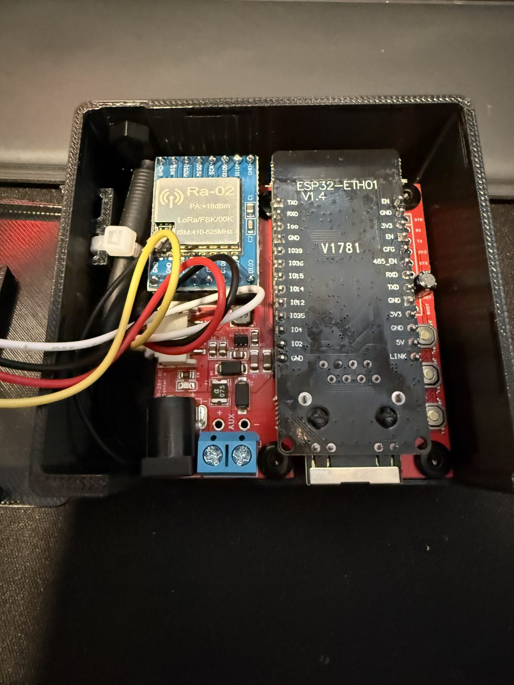

# Case for the carrier board

A printed base and snap-on lid for the Net2RF carrier board (R2.0), in two variants from one OpenSCAD file. Both
have been printed and fitted.

| | **Amp case** (`amp/`) | **Slim case** (`slim/`) |
|---|---|---|
| For | builds with an external 433 MHz amplifier (AB-IOT-433) and its 12 V → 5 V buck | builds without the amplifier |
| Outside | about 87 x 87 x 33 mm | about 73 x 69 x 33 mm |
| Antenna | the amp's OUT SMA, through the far wall | the Ra-02 pigtail's bulkhead SMA, through the same hole; or an internal spring antenna with the hole plugged |

 

Printed and built (more in the [main README](../../docs/build/carrier-board.md#photos)):

<p>
<a href="../../docs/images/carrier/amp-inside.jpg"></a>
<a href="../../docs/images/carrier/amp-closed.jpg"></a>
<a href="../../docs/images/carrier/slim-ext-inside.jpg"></a>
<a href="../../docs/images/carrier/slim-int-inside.jpg"></a>
</p>

## Files

| File | What it is |
|---|---|
| `net2rf_case.scad` | Parametric source (OpenSCAD 2021.01). Every dimension is at the top. |
| `amp/base.stl`, `amp/lid.stl` | Amp case. |
| `slim/base-slim.stl`, `slim/lid-slim.stl` | Slim case. |
| `amp/lid-small-oled.stl`, `slim/lid-slim-small-oled.stl` | Lids for the small 0.96" OLED board (24.7 x 27 mm) instead of the standard 27.9 x 28.3 mm one. Measure yours: the display is the same, only the board differs. Printed and fitted. |
| `slim/antenna-plug.stl` | Blanks the antenna hole of a slim case fitted with an internal antenna. |
| `amp/bracket.stl`, `slim/bracket-slim.stl` | Snap-in bracket that mounts the closed case inside a weatherproof enclosure. |
| `test-pieces/` | Quick fit tests: the small OLED pocket, and the amp bay corner of the base. |

## Printing

No supports for any part.

- **Base:** as exported, floor on the bed.
- **Lid:** already flipped, outer face on the bed. The OLED rails slope at 45 degrees so nothing overhangs.
- **Antenna plug:** as exported, inner face on the bed and stem up, so its crush ribs run up the layers.
- **Bracket:** as exported, plate on the bed.

## Assembly

- The board drops into the base onto four standoffs (plus plain support posts under the left third and under the
  USER and EN buttons). M3 screws cut their own thread in the 2.6 mm pilot holes. The top-left screw sits under
  the edge of the WT32-ETH01, so fit it before plugging the module in.
- **Antenna:** an external antenna is recommended for the best range.
  - Slim case, external antenna: the Ra-02 pigtail's bulkhead SMA goes through the far wall from the inside, its
    hex in the pocket on the inside boss, and its nut outside. The pigtail runs along the left strip to the Ra-02.
  - Slim case, internal antenna: tie the spring antenna to the tie bridge on the left wall with a cable tie, and
    push the antenna plug into the hole. Its ribs hold it, and a finger on the lid stops it being pushed in.
    To remove it, take the lid off and pull it back in by its tab.
  - Amp case: the amp stands on its long edge along the left wall, heatsink towards the wall. Its OUT SMA goes
    through the far wall (nut outside) and its IN end faces the connector end. The buck (heat-shrunk) is strapped
    to the tie bridge at the far wall with a cable tie and takes 12 V from J6. The amp's power can be switched
    by the firmware: see [Amplifier power switch](../../docs/build/amplifier.md#amplifier-power-switch).
- The connector wall above board level is an apron on the lid, with openings for the RJ45, DC jack and screw
  terminal, and `+` / `-` marks beside the terminal's screwdriver holes.
- The OLED slides into the rails under the lid from its header end, glass towards the window, until it stops. A
  dab of glue at the header end keeps it from sliding back. Its cable plugs into J7 (GND, VCC, SCL, SDA).
- The lid's lip drops inside the walls and its ridges click into grooves. Pry it off at the thumb notch.
- USER is a spring tongue in the lid. BOOT and EN are not reachable with the lid on.
- **Bracket:** screw the plate to the enclosure's backplate (four countersunk M4 or #8 screws under the case's
  footprint), then push the case straight down until the arms snap over the lid, which also holds the lid on.
  Pull one arm outwards to release.

## Building other variants

```bash
openscad -o base.stl -D 'part="base"' net2rf_case.scad
```

| Setting | Values |
|---|---|
| `AMP` | `true`: amp case, `false`: slim case |
| `OLED` | `"standard"` (default) or `"small"`: changes the lid only |
| `part` | `base`, `lid`, `bracket`, `plug`; `closed`, `bracket_asm`, `plug_asm` to look at; `oled_test`, `amp_test` for test pieces |

Fit settings worth tuning for a different printer: `SNAP` (lid grip), `CLR` (lid to wall clearance), `FEN_G` (OLED
pocket width), `PLUG_PRESS` (antenna plug grip) and `BR_HOOK` (bracket grip). Bump `REV`, engraved inside the base
and lid, whenever the STLs change. These files are revision **R28**: the slim lid's side snap ridges at the antenna end are shortened so they stop at the end of the lip (on R27 they ran past it; trim them flush on an R27 lid).
